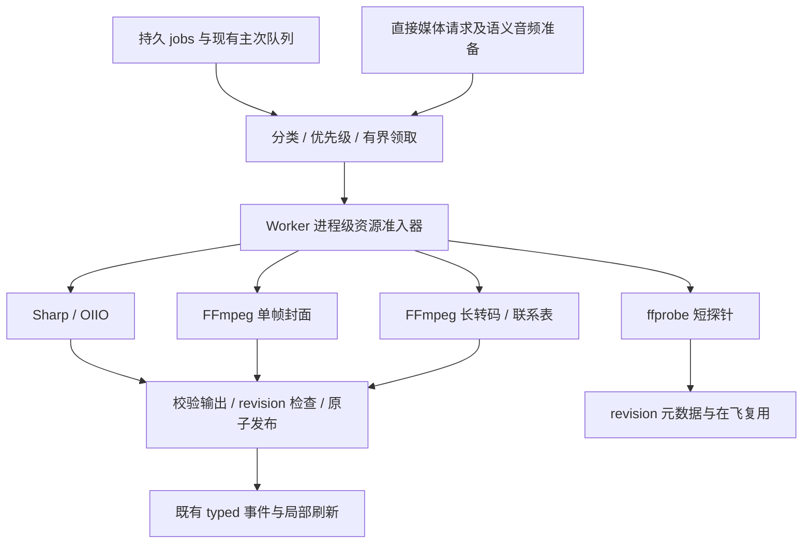

# 缩略图与视频 proxy 加速实施方案

日期：2026-10-20。状态：方案已编写，尚未实施、尚未验收。本文不授权发布，也不表示已获得性能改善。

设计依据：[并发核查](../research/2026-10-20-thumbnail-proxy-concurrency-audit.md)、[媒体资源安全事故与处理](../development/2026-08-25-media-task-memory-safety-development-log.md)、[可见媒体队列与内存预算](../development/2026-08-26-library-performance-architecture-stage-d6-visible-media-queue-development-log.md)。源码参考为 `dev` 的 `589d41aa` 及核查时工作树；编码前必须重新确认最终合流基线。

与[导入算法加速](2026-10-19-import-acceleration-plan.md)并行于产品目标、串行交接共享代码：前者优化文件进入资源库的目录、查重、复制与提交，本方案优化媒体生成、等待与播放恢复。不得将两条路径的收益合并归因。本次仅编写方案，不修改既有工单、实现代码或人工验收状态；实际开发前使用 `node scripts/ticket.mjs` 关联或新建工单，遵守单写者规则。

## 1. 交付目标与范围

目标是提升冷缩略图吞吐、缩短视频播放失败后的 proxy 等待，并在转码期间保持可见卡片、浏览和资源库生命周期可用。多进程是实现手段，资源峰值与最终有效输出共同决定是否采用。

首期必须交付：

- 可观测的等待、探针、解码/转码、发布耗时和进程树峰值。
- 明确的硬件优先编码策略；探针与生产参数一致，Windows Media Foundation 不再以默认软件路径代表硬件成功。
- 跨资源库共享的资源准入器，原子协调任务类型上限、原生内存及 FFmpeg 子进程数量。
- ffprobe 短探针、单帧封面、长转码分开调度；预算允许时支持多个 FFmpeg 子进程同时工作。
- 当前 revision 元数据复用与探针 single-flight；取消、失败、重启和临时文件回收闭环。

后续优化单独决策：受限多线程、硬件解码/缩放、按容器修复的 remux、AI 联系表采样。它们不阻塞首期正确性收口，但首期收益不足时必须继续定位，不能以代码完成代替性能目标。

本方案不改变原文件、导入复制/冲突规则、序列关系、source-first 播放、视频 proxy 最长边 720、不放大和保留原帧率/完整时长的现有语义。不默认降帧率、截短视频、批量提前转码或改变预览画质，不新增用户需要理解线程数的设置。

## 2. 当前事实与根因

| 问题 | 当前源码依据 | 影响 |
| --- | --- | --- |
| FFmpeg/ffprobe 共用一个槽位 | `src/worker/library-service.ts`：`ffmpegDecoderSemaphore`、`runFfmpeg` | 短探针与单帧封面可能等待完整转码；两个队列执行者不等于两个子进程 |
| 进程内也限制线程 | `constrainFfmpegDecoderArgs`、`h264VideoProxyProfile` | 输入解码、CPU 缩放和软件编码可能无法利用可用 CPU |
| 硬件名称不等于硬件路径 | `src/worker/video-proxy-encoder.ts`、`probeVideoProxyEncoder` | h264_mf 排在 NVENC/QSV/AMF 前，但探针及生产缺少 `-hw_encoding 1` |
| 预算与槽位分两次获取 | `runFfmpeg`、`runSharpDecoder`、`src/worker/media-memory-budget.ts` | 等待 decoder 的任务先占预算，放大无效等待；视频通常缺少尺寸估算输入 |
| 元数据探针可重复 | `generateVideoArtifacts`、`generateVideoPoster`、`probeVideoDurationSeconds`、`probeVideoAsset` | 同 revision 可重复启动进程、重复读取源 |
| 交互与后台已有抢占机制 | `src/worker/index.ts`：`noteInteractiveMediaRequest`、`scheduleSecondaryMediaQueue` | 不应另建一套脱离持久队列的执行系统；频繁重启长转码会丢失进展 |

已有保护必须保留：Sharp 后台最多 2、可见图片最多 4；OIIO 单进程；384 MiB 共享估算预算；资源压力退避；同资产主预览优先；proxy 显式请求标记；revision/generation 检查；进程回收和已就绪 artifact 复用。

8 月单槽位来自真实原生内存事故，不能简单撤销。旧的 `thumbnail=300` 已被输入 seek 后单帧输出替代，需以现有链路重新确定合理预算。384 MiB 是准入估算，不是进程树实际 RSS 的硬上限。

## 3. 架构与复用



文件与数据库继续由 Library Worker 唯一持有；Main 仅监督进程和受控媒体协议，Renderer 不接收任意路径/SQL。首期无需新建 UtilityProcess 或常驻 FFmpeg，也不新增数据库迁移。现有 `jobs`、`revision_artifacts`、`EXPLICIT_PROXY_FALLBACK_MARKER` 和事件协议继续复用。

新代码建议放以下独立模块，名称在编码时可按仓库既有等价物调整：

| 模块 | 职责与复用边界 |
| --- | --- |
| `src/worker/media-execution-governor.ts`（新增） | 原子资源准入、取消、公平性、跨库配额、快照；整合现有 semaphore 与 memory budget，不保留两套独立预算 |
| `src/worker/media-memory-budget.ts`（扩展） | 保留纯估算器，补视频解码/线程/缩放/编码占用模型；准入计数只有 governor 一个 owner |
| `src/worker/media-execution-policy.ts`（新增） | 纯任务分类、并发与保守配置、优先级、线程策略 |
| `src/worker/video-proxy-encoder.ts`（扩展） | 平台候选、硬件参数、probe/生产共用 profile builder、回退规则 |
| `src/worker/video-metadata-probe.ts`（新增） | revision 结果复用、single-flight、有限字段解析与取消 |
| `src/worker/media-execution-metrics.ts`（新增或复用日志模块） | 本地结构化阶段计时、聚合；不向 UI 泄漏路径或大量逐帧日志 |

`library-service.ts` 仅保留数据库事务、业务检查与上述模块接线；`index.ts` 仅改队列领取和生命周期接线，不新增巨型内联控制器。复用 `defaultSpawnFn`、`shutdownActiveMediaProcesses`、`MediaResourceGuard` 和既有清理路径，先补缺口再复用，不旁路进程 owner。

## 4. 原子资源准入与并发策略

### 4.1 任务描述和身份

每个执行请求至少携带：libraryId、libraryGeneration、assetId/revisionId（若适用）、jobId/operationId、任务类别、交互意图、AbortSignal、估算内存、解码/滤镜/编码线程策略、编码设备类别。单纯字符串 command 不能决定资源类型；ffprobe 的全片 `count_frames` 不是短探针。

直接生成缩略图、队列任务、编码器探针、损坏图 FFmpeg 回退、音频封面/波形和语义音频转换都要盘点并接入。`handlers/semantic-index.ts` 的直接 spawn 必须复用受控 runner/进程 owner；不能只约束 LibraryService 后宣称整个 Worker 受控。可信第三方插件自行启动的外部工具不在本准入器控制范围，结论必须明确。

### 4.2 首轮候选上限

以下是实验配置，不是已证明最优的发布参数。所有数量为一个 Library Worker 的跨库总量，不能按库累加。P0 工单 Serpent-e468e4 将系统可用物理内存 4 GiB 作为分档：低于 4096 MiB 用保守档；达到或超过 4096 MiB 用常规候选档。

| 资源 | 可用内存 <4 GiB | 可用内存 ≥4 GiB 候选 | 说明 |
| --- | ---: | ---: | --- |
| 常规元数据短探针 | 1 | 2 | 限定字段/输出缓冲；不包含全片帧计数 |
| 单帧封面 FFmpeg | 1 | 2 | 输入 seek，不恢复 thumbnail=N 帧缓存 |
| 长视频/音频转码、联系表、实际编码探针 | 1 | 2 | 互相竞争长任务槽；urgent 优先领取 |
| 视频解码类总数 | 1 | 2 | 封面 + 视频转码 + 联系表 + 编码探针合计；上限不叠加 |
| 受控 FFmpeg/ffprobe 子进程总数 | 2 | 4 | 同时还受各类槽位和共享字节预算限制 |
| Sharp | 后台 1 / 交互最多 2 | 后台 2 / 交互最多 4 | 仍受共享字节预算限制；高档不超过现有上限 |
| OIIO | 1 | 1 | 纳入同一内存计数；不扩大并发 |
| 原生内存估算总预算 | 384 MiB | 384 MiB | 首期不以增加总预算换吞吐 |

分档控制的是同时运行的媒体任务数，不是每个 FFmpeg 的内部编码线程数；FFmpeg 每进程先保持 1 线程，避免进程数与线程数相乘。短探针单独限流且算入总进程数。即使系统内存达到常规档，逐任务估算、384 MiB 共享预算和保留余量仍须准入；未知尺寸或高分辨率输入可独占，不能保证任何 8K 转码下都能并发封面。系统可用内存探测失败时退回保守档，不放宽静态字节预算。

### 4.3 原子获取、领取与释放

1. 持久队列先有界选候选，完成 revision、源可用性、忽略规则与显式 proxy 标记检查，计算资源需求。
2. 在 JS 同步临界区内，governor 同时检查并保留字节、类别槽位、总进程槽位；无任一资源时不占其他资源。排队者保留轻量描述符，不能先扣字节等 decoder。
3. 队列任务获得执行准入后再原子 claim 持久 job；claim 失败或状态变化立即释放。直接调用与队列通过同一 active-operation key 去重，不能双执行同 revision/role。
4. spawn 前再次检查 signal、库 generation、revision 和 external hold；只有已准入请求可以启动 native 工作。
5. 发布前再次检查身份。成功、异常、取消、spawn 同步失败和关闭超时全部经一个幂等 finally 释放；子进程尚未退出时不得提前归还其进程/内存名额。
6. 完成通知触发下一个 drain；禁止用高频轮询或重复 claim 制造 jobs 写放大。

资源租约以一次 native 调用为边界，job 的运行身份则持续到终态。编码子进程退出后释放其执行资源，再独立申请短探针资源校验输出；同样，获取输入元数据的 probe 完成并释放后才申请 poster/proxy 资源。禁止父调用持有长任务或内存租约再递归进入 governor 等待子 probe，避免自锁。两次调用之间仍保留 job 的 active key、取消和 revision 检查，其他请求不能借此重复执行。

领取也必须分类：独立的短探针/主预览候选与长任务候选有各自有界执行机会，不能让两个通用 queue worker 都堵在 proxy 等待上。沿用 wave 的最大领取数与有限队列窗口；新增任务不在事务内 await。没有待执行容量时应退出本轮或等待资源通知，避免一次物化全库 jobs。

现有 Sharp、OIIO 的嵌套 semaphore/memory run 要一起迁移，不能让新 governor 外再套旧预算产生双扣或交叉等待。先用确定性 barrier 测试证明组合不会死锁，再启用并行。

### 4.4 内存模型与超预算输入

视频预算使用源尺寸、像素格式/位深（未知时保守）、解码参考帧、线程缓冲、缩放输出、编码器表面及固定开销；区分 poster、软件 proxy、硬件 proxy、联系表。不能按 720 输出尺寸推断输入帧内存，也不能用文件体积等价代替解码占用。

模型系数由基准中各阶段进程 RSS 校准，保留未知尺寸的保守预留。先以已有 revision 元数据或短探针补尺寸；等待探针期间不持有重任务资源。模型应保存未截断估算值，不能只将大输入裁到 384 MiB 后认为风险已消失。

估算超过预算的合法源采用“单个重任务独占”策略，暂停其它重解码，继续保留取消和资源压力检测；不因本轮优化新增产品格式/尺寸限制。该策略只控制并发，不能保证单个源实际 RSS 不超预算，必须单列 8K/高位深观测。若独占仍触发 OOM，停止扩大并发并记录阻断，不能移除保护或静默标记不支持。

采用可观测的交互预留/重任务准入约束，避免后台任务先占满全部预算。预留量经 P0 基准确定；不为凑配置导致有效工作永远无法进入。对大任务使用有界 aging 和暂缓新后台准入，不无限让小任务插队。

### 4.5 优先级与抢占

短任务池内：当前可见封面优先于预取和后台封面；长任务池内：显式查看器/悬停 fallback 优先于 AI 联系表等后台任务。同级跨库轮转；后台持续有需求时应在有限轮次获得执行机会，具体 aging 参数由测试固定并记录。

保留交互暂停后台 claim 与导入 external hold。显式 proxy 已开始后，普通浏览/轮询不反复终止它；仅相关资产取消、revision 变化、关闭库、退出或真实资源压力可以终止。后台联系表等可取消任务仍让路。取消不等于续传，首期不引入转码切片；测试必须统计被取消后重做的工作量，防止靠不停重启换首屏数字。

## 5. 视频元数据与单帧封面

复用顺序为：当前 revision 已就绪且字段完整的 extracted_metadata → 同 key 在飞 probe → 新的有界 ffprobe。探针统一解析成有限的流、时长、尺寸、旋转、编解码器及必要像素格式字段；保留已有技术元数据提取内容，不能因优化删除 Inspector 字段。

single-flight key 包含 libraryGeneration、revisionId、源快照身份和 probe profile version；仅 assetId 不足以阻止旧结果串入新版本。内存缓存按库关闭、源变化、重新链接和 generation 失效，并有数量上限，不建立全库常驻 Map。

共享探针的一个等待者取消只退出自身；最后一个等待者离开或库失效时终止子进程。失败不永久缓存，OOM/取消不污染格式能力。明确的源消失或权限失败直接返回既有可操作错误。

海报保持现有选帧时间规则、输入侧 `-ss`、只选视频流、禁音频/字幕/data、缩放后输出一帧。禁止恢复 thumbnail=N；旋转、竖屏和短视频须有真实解码断言。探针失败时保持既有可用的封面回退，不能等待全库元数据队列。

## 6. 编码器探测、选择与回退

### 6.1 统一 profile

用共享 builder 构建 probe 与生产编码参数，区分 `hardware-required` 和软件 profile；不要靠 `encoderUsesHardwareName` 判断实际加速。

| 平台 | 首期硬件候选顺序 | 软件回退 |
| --- | --- | --- |
| Windows | NVENC → QSV → AMF → Media Foundation 硬件模式 | OpenH264；H.264 候选都失败时记录失败，不换成 VP9 |
| macOS | VideoToolbox 硬件模式 | OpenH264；H.264 候选都失败时记录失败，不换成 VP9 |
| Linux | 仅对随包可用且实际探测成功的 NVENC/QSV/AMF 候选尝试 | OpenH264；H.264 候选都失败时记录失败，不换成 VP9 |

这是可复现的初始优先顺序，不代表各 GPU 速度排名。候选只在随包 encoder 列表存在时探测。当前 `library-service.ts` 仍将 VP9 列为 fallback；这与用户明确禁止 VP9 的要求冲突，实施时必须删除该回退，并确保没有 H.264 编码器时清楚记录失败。首期不改 FFmpeg 打包依赖或引入 libx264；软件回退沿用现有许可边界。

Media Foundation probe 和生产都显式 `-hw_encoding 1`。VideoToolbox 核查随包 encoder 帮助中禁止软件回退的选项并共用；不支持严格硬件模式时不得标记为硬件已确认。所有平台以实际初始化成功和本地诊断为证据，未知则记录未知，不靠名称宣称。

官方依据：[FFmpeg Media Foundation](https://www.ffmpeg.org/ffmpeg-all.html#MediaFoundation)；实施时以随包二进制 `-h encoder=...` 复核版本差异。

### 6.2 探针与生产失败

- encoder listing 在会话内复用；能力缓存绑定工具指纹、平台及 profile 版本，首期不持久化跨设备可用性。实际设备/驱动状态变化或设备故障允许失效重探。
- 并发请求共享一次能力探测；一帧只证明初始化，P0/P1 必须另跑有时长、与生产像素格式和音轨一致的片段，检查完整产物与真实播放器解码。
- 某硬件生产初始化失败应尝试下一个可用 H.264 候选，再回退到 OpenH264；H.264 都不可用时记录可重试失败，禁止 VP9。每个候选每轮最多尝试一次，不循环重试整片。
- 内容特有的不支持允许换 profile，但不把单个文件失败永久记为整台设备不可用。设备启动/会话失败可短期熔断该 profile；源不存在、权限、磁盘不足不靠换编码器重试。
- OOM/进程创建资源不足走全局退避，不立即串行跑完候选放大资源压力；取消立即终止，不生成 failed artifact，也不继续探测或转码。
- 所有候选失败才记录最终失败，原因包含类别与失败链的脱敏摘要。生产已就绪 proxy 继续复用，不为重新探测而删除有效产物。

## 7. proxy 参数与后续加速

首期保持源帧率/完整时长、720 最大边、现有音频和容器兼容语义。明确选择第一路有效视频流及可选音频，排除无关附件/字幕/data，避免自动流选择造成隐性处理；验证多轨、封面附件、无音频、旋转、透明/高位深源的降级输出符合已有规格。

分开比较输入解码、滤镜和 OpenH264 的 1/2/4 线程配置；线程数变化同时进入内存估算和 CPU 准入，不能每个并发进程各开全核。首期硬件路径可维持保守 CPU 线程，软件多线程在当前平台实测后启用；不测试、不生成 VP9。

硬件解码/缩放作为 P3：分别验证 NVDEC/CUDA、QSV、VideoToolbox 等可用组合的端到端路径；记录 GPU 表面、下载/上传复制、CPU 时间和总耗时。无收益或输入不支持时回到已验证的软件解码+硬件编码组合，不能把硬件解码失败直接变成整个 proxy 失败。[FFmpeg 硬件加速说明](https://www.ffmpeg.org/ffmpeg.html#Advanced-Video-options)指出设备和复制成本会影响收益。

remux 作为 P3 独立候选：仅对已知播放器支持的视频编码、但容器/音频造成失败的路径，尝试 copy-video 和必要的音频转码。若 Renderer 不能实际验证候选，不能把“文件存在”当成 fallback 成功；需要尝试代次与有限升级链，remux 失败后转全视频，避免重复请求同一不可播产物。首期不新增 artifact 类型，若后续需要协议字段必须经 Zod 并补跨进程 E2E。[streamcopy 官方说明](https://www.ffmpeg.org/ffmpeg.html#Streamcopy)。

AI 联系表作为 P3 单独衡量：保留按需生成和 single-flight；全片关键帧计数按长扫描准入，不占短元数据池。比较当前计数+采样与有界多点 seek，评估长 GOP、短片、时间戳和采样覆盖，禁止把这条收益写成普通导入收益。

## 8. 生命周期、磁盘与兼容性

### 8.1 输出发布与清理

每次编码先写资源库 artifacts 所在磁盘的本任务临时文件，使用正式容器扩展名或显式 muxer，避免临时后缀影响格式推断。probe 使用小型受控临时目录，生命周期内 finally 清理；真实转码不得把大中间文件静默写到系统盘。

创建前检查目标盘可用空间，按预计码率×时长、音频、容器开销、faststart 可能的额外写入与安全余量估计；未知时长先 probe。并发磁盘预留也要防止所有任务都看到同一份空闲量后同时写满；检查不替代 ENOSPC 的运行时处理。源/产物位于网络盘时记录其物理读写成本，不默认复制整个视频到本机缓存。

产物关闭后验证：非零长度、ffprobe 可识别、视频尺寸/时长合理、音轨策略正确。核对 generation/revision 后同盘 rename，再登记 ready 和发布既有事件。文件发布与 DB 提交之间失败要有补偿清理；崩溃后启动回收仅凭任务归属和未完成状态清理，不能扫删来源不明或用户文件。

取消或失败等待子进程退出再清理；清理失败必须留下可重试记录和用户可理解提示，不静默残留。重试不得造成 UNIQUE(revision, kind) 冲突掩盖原始失败，也不得破坏此前有效产物。完全退出再启动后对账 job、DB 与文件，不能用复用同一 Worker 代替重启。

### 8.2 关闭、删除与进程退出

库关闭/删除先撤销 generation，停止准入并取消待队列，取消该库运行任务，等待子进程 exit 和文件句柄释放，再按原流程关闭数据库/删除。跨库关闭不能重置进程级计数或误杀另一个库的进程。

复用现有正常退出和异常退出 owner；语义音频转换也必须纳入。Main 被终止、Worker 被终止、spawn 中取消和硬件编码器挂起分别覆盖，确认无孤儿工具、未释放配额和残留临时目录。对停止过程的有界超时与升级终止沿用项目策略，不能新增“媒体太慢就视为成功/删库成功”的捷径。

### 8.3 兼容与回退

首期不改 schema，不占用导入加速预留的迁移号；旧库仍按当前 artifact/job 结构打开。修改生成算法或输出语义时使用既有 generator version 管理，避免重开库无条件重生成全部 ready 预览。单纯调度优化不失效已有产物。

保留内部可注入的保守调度配置：视频解码总数 1、线程 1；用于 A/B 和问题回退，不新增面向用户的工程设置。回退只影响未来准入，运行中任务安全结束/取消后再应用；不重置计数、不删用户数据、不回退数据库。编码策略和调度配置可独立回退，保守档仍应保留 MF 硬件参数正确性与软件 fallback。

## 9. 性能度量与实验设计

### 9.1 分阶段指标

至少记录 queuedAt、eligibleAt、admittedAt、spawnedAt、processExitedAt、validatedAt、publishedAt。区分导入主动暂停、交互让路、资源退避、槽位等待、内存等待、真实 probe/转码和发布，不把正常持久排队时长算成编码速度。

| 指标 | 口径 |
| --- | --- |
| 首张/可见封面延迟 | 视口稳定或导入完成 → 图片 complete 且 naturalWidth > 0；首张和全部可见分别统计 |
| 缩略图吞吐 | 相同冷 artifact 集合的成功发布数 / 墙钟时间，图片与视频分开 |
| proxy 速度 | 源时长 / 实际转码秒数，同时报告包含等待/校验/发布的总等待 |
| 资源 | Worker、所有受控工具的进程树峰值 RSS、CPU/可用 GPU 指标、事件循环 p95/max、原生预算估算及误差 |
| 正确性与清理 | 成功、失败、重试、OOM、取消重做量、跨库公平性、孤儿进程和遗留文件数 |

结构化日志复用 app logger，限制采样频率和缓冲，不保存无限 stderr/逐帧事件；UI 不展示编码器诊断和内部约束。仓库报告只含合成 fixture 标识、相对路径、平台/设备类别，不包含本机路径、用户名、真实文件名、驱动设备唯一标识或凭据。

### 9.2 样本与对照

正式性能回归保持 `tests/worker/large-library-performance.test.ts` 的 20,000 资产混合基线和规定格式/分辨率分布。扩展 `media-task-performance.test.ts` 的视频专项测量，避免现有少量/短视频样本掩盖 proxy 成本；不以小合成图片微基准替代正式基线。

2026-10-20 已完成一次本地真实资产首轮对照，使用 Sharp 0.35.5 与随包 FFmpeg n8.1.2；结果和限制见下表。该运行不是正式 20,000 资产性能门禁，也未清除操作系统缓存或做人眼画质验收；它只用于确定下一步候选。

| 工作负载 | 对照结果 | 解释 |
| --- | --- | --- |
| 150 张 JPEG/PNG/GIF/TIFF 缩略图 | Sharp 外层并发 1/2/4：13.16/24.87/36.88 张/秒；FFmpeg：7.47/13.72/20.86 张/秒。每档两轮，均无失败；两种工具输出总量分别约 3.14/3.09 MB | Sharp 在这组参数下约为 FFmpeg 的 1.76–1.81 倍；编码质量参数并非跨工具严格等价，尚无人眼验收 |
| Sharp 线程设置 | 外层并发 2 时，默认 24 个 libvips 线程为 24.87 张/秒；设为 1 为 27.40 张/秒 | 本轮约快 10%，但只有一个平台和一组混合样本，需在正式基线复核 |
| 20 段 H.264 代理，累计 254.3 秒源时长 | Media Foundation 编码器：串行 20.22 秒（12.58× 实时），并发 2 为 13.83 秒（18.38×）；OpenH264：18.87 秒（13.47×），并发 2 为 12.58 秒（20.21×） | 两种 H.264 输出均 20/20 成功；OpenH264 本轮快约 7–9%，输出略小，但未做同画质校准 |
| 20 段海报抽取 | 输入侧 seek 中位 141 ms、P95 661 ms、最大 1.38 秒；3 段最多前移 30 秒的 seek 对照中，输出侧 seek 更慢或相近 | 保留 `-ss` 输入侧 seek；单段时长很短，需正式长任务继续确认 |

图片样本为 45 JPEG、80 PNG、17 GIF、8 TIFF，输入合计约 748 MB；视频样本为 12 MP4、7 MOV、1 AVI。20 个视频只对每段最多 15 秒做 H.264 代理，样本输入合计约 1.45 GB；原始资源库只读，所有临时输出已清理。数据库可用记录为 7,554，而测试时界面计数为 6,182，口径差异未在本轮调查。

2026-10-20 在指定测试库按同一只读样本重跑了完整派生任务，用以比较当前参数与候选参数的总墙钟时间。样本含 150 张图片（66 JPG、7 JPEG、73 PNG、3 GIF、1 TIFF，输入约 126 MB）和 20 段视频（12 MP4、8 MOV；源视频流为 13 H.264、7 PNG，无 VP9；累计时长 426.3 秒、输入约 611 MB）。每轮同时生成 150 张 512px 图片缩略图、20 张视频封面和 20 个完整时长 H.264 proxy；FFmpeg 任务计入同一并发池。先各预热一轮，再按基线、候选、候选、基线顺序各测两轮。运行包含对应 H.264 编码器的一帧探针；视频源的 ffprobe 时长读取在计时前完成。输出验证在计时后执行。

| 配置 | 两轮正式生成总耗时中位数 | 含输出验证的端到端中位数 | 输出核验 |
| --- | ---: | ---: | --- |
| 当前参数：Sharp 外层 2、libvips 默认 24 线程；`h264_mf`，FFmpeg 总并发 1 | 19.182 秒 | 19.776 秒 | 150/150 缩略图、20/20 封面、20/20 H.264 proxy 成功；输出约 45.9 MB |
| 候选参数：Sharp 外层 2、libvips 1 线程；`libopenh264`，FFmpeg 总并发 2 | 11.664 秒 | 12.220 秒 | 150/150 缩略图、20/20 封面、20/20 H.264 proxy 成功；输出约 42.8 MB |

候选配置在本轮将生成阶段缩短 7.518 秒（约 39%，1.64 倍）；两轮基线为 19.148/19.215 秒，候选为 11.787/11.540 秒。结果来自离线派生基准，不是修改后的产品代码或真正重新导入，因此不含 Worker 排队、数据库发布、IPC 和真实内存准入；时长读取不计入，测试在预热后的本机缓存状态下进行。编码器质量尚未校准，文件大小不能证明画质等价；本轮也未测峰值进程树 RSS。双并发候选仍需通过 Worker 资源准入和内存回归，不能直接据此开放到生产。所有编码仅为 H.264，未运行 VP9。测试临时输出与 manifest 已清理，资源库数据库和源资产保持只读。

两路代理并发将本轮进程树峰值工作集推到约 1.16–1.33 GiB；这是独立基准进程和 FFmpeg 子进程的观测值，不等同于 Worker 的 384 MiB 准入预算。当前生产 FFmpeg 槽位仍为 1；先校准按分辨率和解码器估算的内存预算，再决定是否开放并发，不得仅因吞吐增益直接增大预算。编码器探针显示本机 `h264_mf` 与 OpenH264 可用，NVENC/QSV/AMF 未通过；`h264_mf` 探针不证明硬件加速。

2026-10-21 补做内存压力测量。仍从同一只读资源库取 150 张图片和 20 段视频，扩展名数量与上一轮一致，但上一轮临时清理时已删除逐文件清单，因此本次用按扩展名分层、按 `(asset_id, byte_size)` 确定性取样的新素材；两次样本不是逐文件相同，不混算速度结论。本次图片输入约 98.9 MB、视频输入约 565.2 MB。每轮同时生成 150 张 512px 缩略图、20 张封面及 20 个全时长 H.264 proxy；190 个产物均通过图片解码或 proxy 时长核验。源库只读，输出仅写入本轮隔离临时目录并在验证后清理。编码器严格限制为 `h264_mf` 或 `libopenh264`，没有调用 VP9 编码器。

临时监测器以约 50 ms 间隔跟踪本轮 Node runner 和其活动 FFmpeg PID 的 Working Set、Private Bytes，并每 500 ms 记录系统可用物理内存；实际每轮采到 60–172 个进程样本。表中峰值是进程树内存总和；“任务增量”是峰值减去生成开始前 Node runner 快照，不包含 Electron、Main、Renderer 或其他应用进程。配置使用 Sharp 后台并发 2；当前档 libvips 24 线程，候选档为 1 线程。各档结果：

| 配置 | 实际 FFmpeg 并发 | 进程树峰值工作集 | 进程树峰值私有内存 | 任务峰值增量（工作集 / 私有） | 系统可用内存最低值 |
| --- | ---: | ---: | ---: | ---: | ---: |
| 当前：`h264_mf`（`hw_encoding=0`），libvips 24 | 1 | 525–543 MiB | 597–614 MiB | 458 / 565 MiB（单次带基线采样） | 32.0–32.1 GiB |
| 候选：`libopenh264`，libvips 1 | 2 | 512–514 MiB | 526–528 MiB | 445–447 / 495–496 MiB | 31.8–31.9 GiB |
| 压力档：`libopenh264`，libvips 1 | 4 | 817–834 MiB | 849–869 MiB | 750–767 / 817–837 MiB | 31.5–32.0 GiB |

2 路完成三次，4 路完成两次，1 路配置完成两次（其中一次采集了启动基线）；所有有效轮次均观察到配置对应的最大 FFmpeg 并发数，190/190 产物通过核验。8 GiB 进程树/私有内存保护线和系统可用内存低于 8 GiB 的保护线均未触发。这证明当前机器有足够余量完成这组短时测试，不证明低内存设备或真实 Electron Worker 安全。

本轮没有复现上一段记录的双 proxy 1.16–1.33 GiB Working Set 峰值。两次运行使用的逐文件样本和测试 harness 不同，且本轮没有按 4K/8K、位深和长 GOP 分组；不能用这次较低值覆盖旧观测。完成高分辨率和真实 Worker 对照前，旧峰值仍作为未解释的高水位风险保留。

结果不支持直接把产品任务预算从 384 MiB 提高到任意固定数：本次两路候选的任务私有内存增量约 495 MiB，高于现有估算预算；四路压力档约 817–837 MiB。两路候选比当前档的进程树峰值更低，但本轮同时调整了编码器与 libvips 线程，不能把差值只归因于进程并发。下一步应在真实 Worker 进程测量基线和媒体增量，按输入分辨率/位深、线程及任务类别校准估算，并结合系统可用内存原子准入。可评估“有效容量 = 静态策略上限与（当前可用物理内存 − 经低内存设备验证的系统保留量）中的较小值”；每次重任务 spawn 前重读，内存紧张时停止新准入并让任务排队，后台可取消工作才可让路。系统内存探测本身不是原子保证，也不能替代逐任务估算。未知尺寸或预算不足仍限制为单个重任务。四路只作为压力数据，不是生产建议。完整工作集和 `Private Bytes` 也不能与 384 MiB 的估算口径直接等同，需补真实 Worker 证据后才能决定是否调整准入预算。

临时基准命令：`node scripts/run-vitest-with-electron.mjs run --config vitest.config.ts tests/worker/real-media-benchmark-temporary.test.ts --disableConsoleIntercept --reporter=dot`；测试完成后已删除临时 spec、源清单和输出目录。正式对照仍应使用稳定、脱敏 fixture 并补上校准画质、冷/热缓存说明和 20,000 资产门禁。

#### 图片解码与压缩工具矩阵

先量产当前实现基线：Sharp 0.35.5/libvips 路径、JPEG opaque 512px quality 72、带 alpha 的 WebP quality 80、EXIF rotate、sRGB、within bounds、without enlargement；记录实际输出 bytes。随后仅对 Sharp 与 FFmpeg **都能正确解码**的重叠格式，使用同一源字节和同一输入集合，建立离线 benchmark adapter 比较：

| 对照项 | 固定条件与输出 |
| --- | --- |
| Sharp 当前默认路径 | 与 production 一样的 input options、resize/kernel、颜色和旋转语义、输出编码与质量参数 |
| FFmpeg 同目标路径 | 相同源文件、解码方向、旋转/颜色处理和 512 上限；使用经实际编码校准的 JPEG/WebP encoder 参数 |
| FFmpeg 线程 A/B | 输入 decoder 与 filter 分别设 1、2、4；与生产默认 1 线程对照，不能一方吃满所有核心 |
| OIIO 适用格式 | 仅当它和另两种工具都支持 fixture 且能表达相同色彩/alpha/尺寸语义时参与同组；RAW/EXR/TIFF 等 format-specific 路径单独报告 |

首批交集可覆盖常见 JPEG、PNG、WebP；每个文件只纳入所有参赛路径都实际解码成功的配对组。GIF 动图需沿用选帧策略后另行比较；SVG、PSD、RAW、EXR 以及其它不等价/不支持格式不能和普通 raster 合并平均。保留透明度、方向、色彩空间、元数据边界；若 FFmpeg 与 Sharp 无法达到相同视觉语义，记录不等价，不纳入胜负结论。

输出编码器的 quality 数值不是跨工具统一尺度。先用参数扫描分别校准“同目标输出大小”和“相近画质”两种模式，再比较每张墙钟时间、张/秒、CPU、Worker 与子进程峰值 RSS、输出字节和 SSIM/PSNR 辅助指标；最终对有 alpha、细线/UI 图、照片分别盲检画面，不以单个客观分数替代人眼。清晰度/色差、方向或 alpha 出错即判该路径不等价。

每条记录分开报单张冷解码/热 OS cache 与当前生产调度下整批总时间。先用 1 个任务测引擎自身时间，再用现行生产配置测系统吞吐（Sharp 后台最多 2，FFmpeg 当前 1 子进程），最后在受控预算下测多进程候选。这样不会把 semaphore 数量差异冒充 Sharp 内核本身的速度差异；测工具基础性能时也不能关闭资源保护或超额占内存。

#### 视频 proxy 编码器矩阵

同一源文件、stream map、转码区间、缩放、帧率、音频和 mux 条件下比较已验证的 H.264 硬件候选与 OpenH264；分别报告硬件实际初始化结果，`encoder` 名称/一帧探针通过不算硬件证明。按“同目标码率/文件大小”和“近似画质”两种模式记录 proxy 完成秒数、source-duration / elapsed 的实时系数、time-to-first-playable、产物大小、CPU/GPU、总 RSS 和播放器能否真正播放。包括短片（启动成本）和分钟级素材（稳态 throughput）、H.264/HEVC 输入与长 GOP；不测试或生成 VP9，结果按编码器、输入 codec、操作系统/设备分组。

另用原文件已有 AAC/Opus 与不兼容音轨分别测音频 stream-copy 和重编码。stream-copy 只作适用容器/codec 的子组，不将不兼容的路径拿来宣称更快。对比软件解码+硬件编码、硬件解码+缩放/编码等阶段时一次只改变一类参数，记录探针、排队和输出验证的完整端到端时长。

交叉对照脚本必须写临时输出到本轮创建、预检空间的隔离目录，逐个写完/验证后清理；记录输入和参数的匿名 fixture id，不复制真实素材或机器路径进仓库。工具版本以本轮 bundled binary / package manifest 为准，并记录 encoder/filter/build capabilities。

另外创建自有视频夹具：1080p/4K/8K，24/30/60 fps，短片与至少一条分钟级长片，H.264/HEVC、MP4/MOV/MKV、长 GOP、无音频/多音轨、竖屏/旋转、高位深及损坏文件。8K 长片按空间和运行成本控制样本量；不支持的合成编码器记录缺失，不借用私人媒体。覆盖至少两个库竞争、proxy 与冷封面同时运行、导入暂停、快速滚动、重复 fallback 和关闭重开。

固定 A 为优化前最终合流代码，B 为候选；记录 commit 与未提交差异身份。使用同一检出串行构建，按仓库规则用 stash 串行切换或保留仓库外对照构建，禁止 worktree。不得 stash 或覆盖归属不明的并行工作，交接到可冻结基线后再做 A/B。

每个样本先预热一次，至少三个独立冷 artifact 轮次，交替 A/B 顺序；冷 artifact 不等于清空 OS 缓存，要记录 OS cache 条件。报告每轮原始值、p50/p95/max、成功率和波动。硬件组、软件 fallback 组、单库/跨库、本地/网络盘分组，不把跨平台结果混算。

### 9.3 目标与启用规则

- 正确性是硬门禁：无新增数据损坏、跨 revision 发布、重复执行、死锁、孤儿进程、无提示残留、资源错误循环；模拟错误与真实工具用例同时覆盖。
- 视频封面目标：相同多视频冷集合吞吐相对 A 提升至少 30%；并存 proxy 时已知轻量封面获得执行机会，不等待整片转码结束。若低核或预算只容一个重任务，明确记录限制，不伪造并发达标。
- proxy 目标：至少在受影响的 Windows 硬件组，相同素材转码中位耗时降低 30%；若 A 已实际使用硬件则单列，不宣称同幅提升。软件回退不出现稳定超过 10% 的耗时退化，质量和可播性保持。
- 保持项目体验目标：文件夹首屏约 500 ms、Inspector 约 500 ms、搜索首屏约 1 s；记录开库/切库响应，不让预览生成变成结构一致进入主界面的前置条件。延续 UI-0006 的超过 3 秒才显示简洁等待提示。
- 进程树 RSS 不出现无法解释的持续增长；首轮沿用现有媒体性能套件的 RSS 增量门槛，并按平台披露基线/峰值。通过增加常驻内存取得速度必须另行评估，不能把 384 MiB 估算当实际内存通过证据。

上述百分比是拟定优化目标，不是当前结果或每次共享环境硬断言。若收益不明显，定位 queue/probe/decode/scale/encode/IO 各阶段后调整；有稳定退化或资源失败则关闭对应优化配置，不能只展示最好一轮。

## 10. 实施阶段与退出条件

| 阶段 | 改动 | 必需交付与退出条件 |
| --- | --- | --- |
| P0：基线与诊断 | 执行阶段计时、受控工具调用盘点、补视频样本；建立生产 A 对照及 Sharp/FFmpeg 同源工具矩阵 | 能解释真实编码器、等待与处理占比；有图片单张/整批、不同输出格式体积/画质、视频 proxy 硬软编码配对证据；记录原始测量和工具版本。测量代码本身不得改变生产调度 |
| P1：编码策略 | profile builder、MF 硬件模式、平台候选、single-flight 探测及完整回退链 | 单测检查关键参数；真实生产片段与播放器解码；取消/OOM/设备失败不错误回退。可独立验证收益 |
| P2a：统一准入 | 原子 governor、Sharp/OIIO/FFmpeg/语义音频接入、保守配置不扩并发 | 保持视频总数 1 的等价行为；取消/释放/跨库/生命周期合同全绿，无双扣与死锁 |
| P2b：并发与 probe 复用 | 分类领取、元数据 single-flight、候选多进程配置和公平性 | barrier 证明真实执行可并行；正式基准证明收益与内存可接受；proxy 不因普通交互反复重启 |
| P3：测量后调优 | 线程、硬件解码/缩放、remux、AI 联系表分别小步实验 | 每项独立 A/B、兼容与清理证据；有收益才启用，不捆绑多个变量冒认根因 |
| P4：最终集成 | 最终共享检出回归、独立审查、真实 UI 和 packaged 平台矩阵 | 四列证据齐备才标对应范围完成；未执行平台仍未验证，人工验收由用户确认 |

每阶段开始时关联实际工单并建立开发日志，记录范围、基线、reuse 点、命令和结果。P2 为跨模块功能开发，需独立最终 Standards/Spec 审查；按仓库要求启动审查/测试 subagent 前先询问本次模型，只启动一个审查 agent。不沿用其他会话或导入加速轨道的模型授权。

共享 `library-service.ts`、`index.ts`、协议及测试由一个集成者串行接线，不与导入加速同时编辑。不创建第二检出。若基线仍有测试失败，先记录并定位可复现失败，不靠重跑覆盖；最终门禁必须针对最终代码执行。

## 11. 自动化、人工与平台验收

### 11.1 测试内容

| 层级 | 必测内容 |
| --- | --- |
| Unit | 原子资源获取、队列等待不扣预算、混合上限、超预算独占、aging、跨库公平、取消释放/幂等；profile 硬件参数与顺序；线程估算；probe 在飞引用计数与失效 |
| Worker 集成 | 真实 jobs claim、跨 service/库共享预算、不同任务组合、重 revision/重开库、source-direct 不误转码、有效 artifact 复用、错误分类与候选降级；移除“全部 FFmpeg/ffprobe 永远只能 1”旧断言并以分类/预算合同替代 |
| 真实媒体工具 | 正确参数被随包二进制接受、硬件不可用回退、FFmpeg 输出可被 ffprobe 解读，临时空间预检/ENOSPC/清理失败；mock 不能代替真实视频 |
| Electron E2E | 导入后图片真实解码；proxy 与冷封面共存；source-first→播放失败→proxy 的实际元数据/非零尺寸/播放时间推进；快速切资产/跨库取消；完整退出重启后复用；关闭/删除库不占句柄 |
| 故障与回收 | 在领取、spawn、编码、rename、DB 提交前后触发 failpoint，实际重启后对账；Main/Worker 异常退出无孤儿；清理失败可见且可重试 |

同一进程使用 barrier 的并发测试只能证明准入合同，真实进程和 RSS 另测。故障路径必须记录 failpoint 实际触发、退出/重启及 DB/文件核对；代码存在不算覆盖。

### 11.2 命令与运行纪律

文档阶段不运行产品测试。进入代码阶段后按改动执行以下命令；新增测试文件名以实现最终落点为准，不能在尚未创建时记为已跑：

```bash
npm run typecheck
npm run lint
node scripts/run-vitest-with-electron.mjs run --config vitest.config.ts tests/unit/media-concurrency.test.ts tests/unit/media-memory-budget.test.ts tests/unit/video-proxy-encoder.test.ts tests/worker/video-exr.test.ts tests/worker/thumbnails.test.ts tests/worker/thumbnail-throughput.test.ts
npm run test:library-availability
node scripts/run-e2e.mjs tests/e2e/media-preview.test.ts tests/e2e/media-video-playback.test.ts tests/e2e/asset-ingestion.test.ts tests/e2e/process-lifecycle.test.ts tests/e2e/library-switch-handle-release.test.ts
```

正式性能命令为 `npm run test:perf:media-tasks --` 和 `npm run test:perf:large-library --`，末尾均需传入本轮自有的正式混合 fixture 目录；不在仓库记录本机绝对路径。补充新并发/元数据/回收测试，并按实际接入语义音频范围运行其相关测试。

任何修改 `library-service` 或 library Worker 协议必须完整跑资源库可用性门禁；跨进程/媒体链路必须跑真实 Electron。最终大型功能集成运行 `npm run verify:mainline`，不能用本表的局部命令替代。

所有自动化后台运行，Electron 使用独立临时 `SERPENT_E2E_USER_DATA_PATH` 并设置隐藏窗口策略；核对 harness 实际支持 `SERPENT_E2E_HIDE_WINDOW=1`，不能把 `run-e2e-isolated` 自动等同于无前台抢占。需真实前台交互时先征得用户同意；主 agent 串行运行 E2E。

测试前预检磁盘空间，确认可创建完整 fixture/对照副本/输出。结束后确认进程退出，清理本轮临时媒体、库、profile、截图和日志等产物；需要长期留存的证据转成脱敏报告，不能因此保留大体积临时目录。只清本轮可证明归属的路径，Windows 递归清理前验证解析后目标及 junction 边界。

### 11.3 四列追溯与人类队列

下表是需求设计映射，不是实现证据；当前实现/测试行号与平台证据均缺失，全部为未实施。每阶段落地后填写真实 `file:line`、当次测试命令/摘要及证据。

| 需求条目 | 计划实现位置（实际 file:line 待填） | 计划自动化测试（实际 test:line 待填） | 人工/平台证据 |
| --- | --- | --- | --- |
| MEDIA-FAST-001：可解释的等待/处理耗时 | metrics、governor、既有日志 | 阶段计时/采样上限 unit、真实工具基准 | 未执行 |
| MEDIA-FAST-002：硬件优先与可靠回退 | video-proxy-encoder、service 接线 | encoder unit、video-exr、真实 proxy E2E | Windows/macOS/Linux 设备矩阵未执行 |
| MEDIA-FAST-003：原子预算下的多进程 | governor、memory-budget、index 分类领取 | 新 governor unit/Worker、跨库 barrier、RSS 基准 | 真实混合负载未执行 |
| MEDIA-FAST-004：探针复用、单帧封面 | video-metadata-probe、poster 接线 | revision/取消 single-flight unit、真实长 GOP 片段 | 导入/滚动/竖屏人眼检查未执行 |
| MEDIA-FAST-005：转码与浏览共存 | 分类队列、urgent 生命周期 | 冷封面+proxy E2E、跨库、交互轮询 | Computer Use/用户未执行 |
| MEDIA-FAST-006：磁盘与进程回收 | runner、artifact 发布、退出 owner | ENOSPC、取消、重启 failpoint、进程生命周期 E2E | Windows 占用/关闭/删除未执行 |
| MEDIA-FAST-007：可选线程/GPU/remux 优化 | P3 各独立模块 | 各自 A/B、播放兼容和升级回退 | 未实施，不能并入首期验收 |

仅在已实现、相关自动化通过、无范围阻断且能写清操作步骤后，把 002/004/005/006 拆成最小可操作项目加入 `human-acceptance-checklist.md`；001/003 技术合同留 QA 证据，不伪造人类验收。需要用户实际验证的示例为：导入视频后首屏封面、正在生成 proxy 时继续浏览、重开后不重复生成、转码时关闭/删除库。

主 agent 在最终源码构建中通过 Computer Use 检查导入、工作态、播放恢复和失败提示，截图使用自有 fixture。不具备真实桌面控制能力则记未执行并移交人工，隐藏窗口 E2E 不冒充 Computer Use。用户确认后才更新人工通过和关闭相应工单。

开发态 Windows、macOS arm64 是首期重点；Linux 随已交付平台单列回归。packaged 必须用当前提交重新构建并验证媒体工具与实际播放，旧包不作证据。打包仅在 dev，遵守发布流程；结束执行 `npm run rebuild:native` 恢复开发环境。未运行平台、无可用硬件组和不支持的 GPU 路径均明确写未验证。

## 12. 风险、触发条件与处理

| 风险 | 信号 | 处理 |
| --- | --- | --- |
| 并发回到旧 OOM 故障 | ENOMEM、allocator 错误、RSS 非线性增长 | 立即停止新重任务、沿用退避；降为保守并发；重新校准尺寸/线程估算，禁止取消保护 |
| 优先级导致后台饥饿 | 持续交互后后台无启动机会、重复取消 | 分类别公平/aging、保留已开始显式 proxy；报告等待原因和重做量 |
| 原子准入仍被双重预算包裹 | 配额不归零、无进程却无容量 | P2a 先不扩并发，清理旧 semaphore 嵌套；barrier 覆盖混合请求 |
| MF/硬件驱动不支持 | 探针失败或生产初始化失败 | 下一个硬件候选/软件 fallback；区分设备与文件失败，不永久缓存全局失败 |
| 硬件编码快但总体仍慢 | decode/scale/IO 占比高 | 针对占比进入 P3；不继续盲加编码进程 |
| 取消或崩溃残留文件 | partial 输出、未登记 artifact、句柄占用 | 等待 exit、补偿清理、启动对账和明确再次清理入口 |
| 共享工作树证据串线 | 基准期间源码/依赖变化 | 串行冻结基线，记录最终树，重新执行受影响测量；不使用 worktree |

完成定义：首期需求有当前实现和测试定位；正式基线与视频专项有原始对照结果；资源库可用性和真实 Electron 通过；独立审查无阻断；当前构建的必要平台证据齐备；临时文件与进程全部对账；用户验收条目按真实反馈更新。任何缺列仅报告部分完成或未验证，不以单项提速替代全范围完成。
