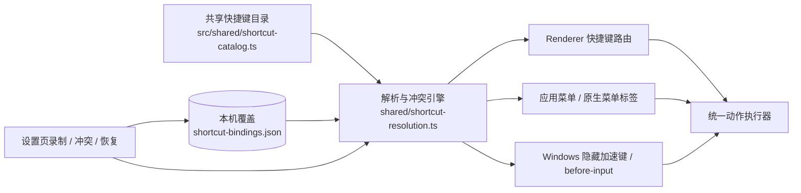

# 自定义快捷键完整方案

> 日期：2026-10-17
> 工单：`Serpent-963e00`
> 状态：R1/v1-lite、R2a/R2b 与全屏/查看器导航/修饰鼠标侧键 follow-up 均已实现并完成对应自动化；仍待人类/平台验收。插件与滚轮手势仍未实现。
> 最近实现：2026-10-17；自动化证据与未验证的平台边界见开发日志和人类验收清单。
> 关联：`docs/internal/ui/0003-keyboard-shortcut-ux-principles.md`
> 开发日志：`docs/internal/development/2026-10-17-custom-shortcuts-development-log.md`

## 1. 结论

可以做，但不能只加一个「录制按键」的设置页。

Serpent 现在已经有一套命令注册表和按平台声明的快捷键，但快捷键事实分散在五个地方：命令定义、应用主菜单、查看器媒体键、Windows 隐藏加速键、插件 manifest。任何一处没有跟着用户覆盖更新，就会出现「菜单写着新键、按下去触发旧命令」或「渲染进程改了、系统菜单仍然抢键」的问题。

推荐方案是：

1. 建立一份 **共享快捷键目录（catalog）**，把每个可配置动作的默认键、作用域、展示名和分发入口集中声明。
2. 在目录之上加一层 **解析器（resolver）**：默认键 → 本机覆盖 → 当前平台的有效键。
3. 把覆盖保存到 **Main 进程拥有的本机偏好文件**，通过窄 IPC 暴露给 Renderer；Main 用它重建原生菜单、Windows 隐藏加速键和 `before-input-event` 匹配。
4. Renderer 用同一个解析器驱动命令注册表菜单、右键菜单、键盘监听和设置页。
5. 设置页只负责录制、冲突处理和恢复默认；它不拥有第二套快捷键逻辑。

这样用户改一次键，菜单文案、右键提示、渲染进程按键、系统菜单加速键和 Windows 隐藏加速键会一起变。

### 1.1 相对 2026-09-27 初版方案的调整

| 初版方案 | 本方案 | 原因 |
| --- | --- | --- |
| 认为命令表已经是唯一来源，只缺覆盖层 | 先建立覆盖五类来源的共享目录 | 主菜单、查看器、Main 隐藏加速键、插件并不读命令表 |
| 覆盖存 Renderer localStorage | 存 Main 的 `userData/shortcut-bindings.json` | 原生菜单和隐藏加速键在 Renderer 加载前就要注册，localStorage 会产生启动期旧键窗口 |
| 查看器 D/F/X/C、Windows 隐藏加速键留到后续 | 纳入完整方案，Phase 2/4 必做 | 不覆盖这些入口，Windows 中文输入法下会出现「设置页改了、实际仍按旧键」 |
| 插件快捷键不做 | v1 只读展示 + 禁用开关，v2 再考虑覆盖 | 至少要让用户看见插件与内置命令的冲突 |
| 以单文件设置页为主 | 目录 / 解析器 / Main 存储 / 设置页分层 | 让菜单、键盘、Main 加速键共享同一份结果，避免幽灵快捷键 |

## 2. 现状审计

### 2.1 当前快捷键的五类来源

| 来源 | 位置 | 现状 | 问题 |
| --- | --- | --- | --- |
| 命令定义 | `src/renderer/commands/*.ts` | 资产、文件夹、合集、工具栏命令自带 `shortcut` | 只有命令注册表消费，菜单之外还有独立匹配器 |
| 应用主菜单 | `src/renderer/main-menu-items.ts` | 撤销、重做、复制、粘贴、全选、反选、全屏等写死 `shortcut(platform, mac, windows)` | 与命令定义的 id、默认键各写一份 |
| 查看器 | `video-player-controls.ts`、`viewer-volume-preferences.ts`、`zoomable-preview-image.tsx`、`App.tsx` | Space、D/F、X/C、Ctrl+←/→、↑/↓、小键盘 `.`、Esc、←/→ 等直接写键 | 没有统一动作 id，也没有覆盖入口 |
| Main 进程 | `viewer-video-shortcut-menu.ts`、`main/index.ts`、`application-menu.ts` | Windows 隐藏菜单和 `before-input-event` 写死 F2/Delete/Shift+Delete/F11/D/F/X/C | 改键后 Main 仍按旧键拦截 |
| 插件 | `plugin-shortcut-contributions.ts`、`plugin-accelerator.ts` | 插件 manifest 声明 Electron accelerator，Renderer 动态匹配 | 与内置命令的冲突只对照旧 QA 表，不包含查看器和菜单项 |

### 2.2 审计发现的硬问题

- **多份默认键表**：`platform-shortcut-table.ts`、命令定义、主菜单、查看器常量、隐藏菜单各自维护一份，已经出现漂移风险。
- **幽灵快捷键**：代码审计发现至少 `folder.copy`、`folder.paste`、`collection.create-subcollection` 在菜单里画了快捷键，但 `use-folder-command-shortcuts` / `use-collection-command-shortcuts` 没有对应键盘分发。菜单写了的键必须真能按出来，这是 UI 0003 的硬约束。
- **主进程抢键**：macOS 原生菜单加速键和 Windows 隐藏菜单会在 Renderer 之前触发；只改 Renderer 的匹配器不会改掉系统菜单的旧键。
- **输入法与键盘布局**：裸字母键在中文输入法下可能得到 `key: "Process"`；现有匹配器有 `code`/`keyCode` 兜底，但自定义录制如果不保存物理键，会重新引入 IME 问题。
- **作用域重叠**：Space 在浏览画布是「打开资产」，在视频查看器是「播放/暂停」；Ctrl+C 在资产画布是复制文件，在文本框里是复制文本。不能用一张扁平冲突表判断。
- **没有任何用户覆盖存储**：当前只有默认值，设置页没有可修改的数据源。

### 2.3 当前默认键位盘点

下表是现状盘点，不是最终目录；统一目录后所有行都会有稳定的 action id。

| 分组 | 动作 | Windows | macOS | 当前入口 |
| --- | --- | --- | --- | --- |
| 应用 | 撤销 | Ctrl+Z | ⌘Z | 主菜单 |
| 应用 | 重做 | Ctrl+Shift+Z | ⌘⇧Z | 主菜单 |
| 应用 | 全选 | Ctrl+A | ⌘A | 选择键盘 / 主菜单 |
| 应用 | 反选 | Ctrl+I | ⌘I | 选择键盘 / 主菜单 |
| 应用 | 聚焦搜索 | Ctrl+F | ⌘F | 发现工具栏 |
| 应用 | 刷新 | F5 | F5 | 工具栏命令 |
| 应用 | 窗口全屏 | F11 | ⌃⌘F | Main / 主菜单，可自定义 |
| 应用 | 放大 / 缩小 / 重置 | Ctrl+= / - / 0 | ⌘= / - / 0 | 全局缩放 |
| 资产 | 查看 | Enter（Space 为别名） | Enter（Space 为别名） | App |
| 资产 | 用系统程序打开 | Ctrl+O | ⌘O | 命令 |
| 资产 | 在文件管理器显示 | Ctrl+Shift+S | ⌘⇧S | 命令 |
| 资产 | 在库内定位 | Ctrl+B | ⌘B | 命令 |
| 资产 | 复制 | Ctrl+C | ⌘C | 命令 |
| 资产 | 粘贴 | Ctrl+V | ⌘V | 命令 |
| 资产 | 复制路径 | Ctrl+Shift+C | ⌥⌘C | 命令 |
| 资产 | 重命名 | F2 | F2 | 命令 |
| 资产 | 移入回收站 | Delete | ⌘⌫ | 命令 |
| 资产 | 从硬盘删除 | Shift+Delete | ⌥⌘Delete | 命令 |
| 文件夹 | 在文件管理器显示 | Ctrl+Shift+S | ⌘⇧S | 命令 |
| 文件夹 | 新建子文件夹 | Ctrl+Shift+N | ⌘⇧N | 命令 / 键盘 |
| 文件夹 | 重命名 | F2 | F2 | 命令 / 键盘 |
| 文件夹 | 复制 | Ctrl+C | ⌘C | 菜单（键盘分发缺失） |
| 文件夹 | 粘贴 | Ctrl+V | ⌘V | 菜单（键盘分发缺失） |
| 文件夹 | 移入回收站 | Delete | ⌘⌫ | 命令 / 键盘 |
| 文件夹 | 从硬盘删除 | Shift+Delete | ⌥⌘Delete | 命令 / 键盘 |
| 合集 | 新建子合集 | Ctrl+Shift+N | ⌘⇧N | 菜单（键盘分发缺失） |
| 合集 | 重命名 | F2 | F2 | 命令 / 键盘 |
| 合集 | 删除 | Delete | ⌘⌫ | 命令 / 键盘 |
| 查看器 | 关闭 | Esc | Esc | App（固定） |
| 查看器 | 上一个 / 下一个资产 | ← / → | ← / → | App，可自定义；支持鼠标后退/前进侧键 |
| 查看器 | 复制当前资产 | Ctrl+C | ⌘C | 查看器 |
| 查看器 | 适配窗口 | 小键盘 `.`（图片另有 Space / F 别名） | 同左 | 查看器 |
| 查看器 | 音量增 / 减 | ↑ / ↓ | ↑ / ↓ | 查看器 |
| 视频 | 播放 / 暂停 | Space | Space | 视频 / GIF |
| 视频 | 上一帧 / 下一帧 | D / F | D / F | 视频 / Main |
| 视频 | 减速 / 加速 | X / C | X / C | 视频 / Main |
| 视频 | 后退 / 前进 2 秒 | Ctrl+← / Ctrl+→ | Ctrl+← / Ctrl+→ | 视频 |
| 插件 | 插件声明的快捷键 | manifest | manifest | 插件 |

## 3. 设计原则

1. **以动作为中心，不以按键为中心**。用户改的是「重命名」这个动作的键，不是「把 F2 换掉」。
2. **单一真相**。默认键、用户覆盖、菜单标签、键盘匹配、Main 加速键都从同一份目录和同一个解析器出来。
3. **没有幽灵快捷键**。一个动作被标记为可配置，就必须列出它的全部生效入口；任一入口仍读旧常量，测试失败。
4. **平台分开保存**。Windows 与 macOS 的系统保留键、修饰键习惯不同，不把一个平台的键位硬套到另一个平台。
5. **上下文优先**。输入框、输入法组合、模态框、查看器、侧栏焦点、浏览画布、全局之间按明确优先级分发；自定义不能绕过这条规则。
6. **保守开放**。只开放可解释、可恢复、可验证且有完整运行时路由的动作；文本系统编辑键和查看器关闭键保持固定。查看器上一项/下一项允许自定义，因为其查看器作用域、输入让键和边界守卫完整。
7. **改键立即生效，重启保持**。设置页不做「保存后才生效」的临时状态，避免菜单和实际按键不一致。

## 3.1 方案取舍

| 方案 | 做法 | 优点 | 致命问题 |
| --- | --- | --- | --- |
| A. 只在 Renderer 加覆盖 | 保留现有各监听器，读取 localStorage 覆盖并替换匹配器 | 改动小，能快速做出设置页 | 原生菜单、Windows 隐藏加速键、输入法兜底仍用旧键，用户会遇到「菜单显示的键按不出来」 |
| B. 共享目录 + 解析器 + Main 存储（推荐） | 默认键/覆盖/菜单/键盘/Main 加速键统一解析 | 一处修改，所有入口同步；可测试、可迁移 | 初期改动面较大，需要拆 PR |
| C. 引入第三方 keybinding 库 | 用库管理 chord 解析和录制 | 录制与冲突逻辑现成 | 库只覆盖 DOM，不理解 Electron 菜单、IME、原生 role、隐藏加速键，仍要自己做 B 的大部分工作 |

推荐 B。A 适合做原型，不适合作为最终发布架构。

## 4. 目标架构



### 4.1 共享目录

新增 `src/shared/shortcut-catalog.ts`，只放纯数据，不依赖 React、Electron、i18n 运行时：

```ts
type ShortcutPlatform = "mac" | "windows";

type ShortcutScope =
  | "app"
  | "browse"
  | "sidebar"
  | "viewer.base"
  | "viewer.image"
  | "viewer.video"
  | "viewer.audio"
  | "viewer.pdf"
  | "viewer.text";

type ShortcutChord = {
  /** 逻辑键，用于显示与命名键匹配，例如 "s" / "F2" / "Delete" / "ArrowLeft" / "MouseBack"。 */
  key: string;
  /** 物理键，字母/数字/F 键优先用它匹配，避免输入法与键盘布局漂移。 */
  code?: string;
  metaKey?: boolean;
  ctrlKey?: boolean;
  altKey?: boolean;
  shiftKey?: boolean;
};

type ShortcutAction = {
  id: string;
  labelKey: string;
  category: "app" | "file" | "edit" | "view" | "workspace" | "viewer" | "plugin";
  scopes: readonly ShortcutScope[];
  /** 第一个是主键，其余是固定别名（例如 Enter 的 Space、适配的 Space/F）。 */
  defaults: {
    mac: readonly ShortcutChord[];
    windows: readonly ShortcutChord[];
  };
  /** false 表示在设置里显示为固定键，并给出原因。 */
  customizable: boolean;
  fixedReasonKey?: string;
  /** 声明这个动作会被哪些入口消费，覆盖率测试据此检查。 */
  surfaces: readonly ("renderer" | "app-menu" | "native-menu" | "hidden-accelerator" | "before-input" | "plugin")[];
};
```

目录是**默认值和元数据的唯一来源**。命令定义里的 `shortcut` 在迁移期保留为兼容字段，迁移完成后删除或由测试强制与目录一致。

### 4.2 解析器

新增 `src/shared/shortcut-resolution.ts`，全部是纯函数：

- `resolveBinding(actionId, platform, overrides)`：返回 `ShortcutChord[]`，第一个是主键。
- `formatChord(chord, platform)`：`⌘⇧S` / `Ctrl+Shift+S`。
- `matchesChord(chord, event)`：支持 `code` → `key` → 旧 `keyCode` 的降级匹配。
- `findConflicts(actionId, chord, platform, catalog, overrides, pluginShortcuts)`：返回同作用域冲突和跨作用域遮蔽。
- `isReservedChord(chord, platform)`：系统/Electron 保留键校验。

Renderer 与 Main 共用同一份解析器。不能一边用 `matchesShortcut(ShortcutSpec)`，另一边用自定义结构。

鼠标后退/前进使用 chord key `MouseBack` / `MouseForward`，由 DOM `MouseEvent.button` 3/4 和同一事件携带的 Ctrl/Alt/Shift/Meta 修饰键匹配；至少需要一个修饰键，不生成 Electron accelerator。所有可自定义动作共用同一鼠标事件到 action matcher 的路由，设置录制、IPC、导入导出、冲突/保留键校验和运行时使用一致的 chord。捕获阶段阻止已修饰侧键触发 Chromium 的 history 默认行为；裸侧键不保存并保留系统行为。固定动作、插件动作及不属于快捷键目录的功能不接受侧键绑定。

### 4.3 覆盖存储

**存在 Main 进程的 `userData/shortcut-bindings.json`，不存资源库数据库。**

原因：原生菜单在窗口创建前构建，Windows 隐藏菜单和 `before-input-event` 也属于 Main；如果只存 Renderer 的 localStorage，启动时会先按默认键注册，之后才异步改菜单，必然出现一段「旧键还能用」的窗口。

建议格式：

```json
{
  "version": 1,
  "platforms": {
    "mac": {
      "folder.rename": { "key": "F2", "code": "F2" },
      "folder.create-subfolder": null
    },
    "windows": {
      "folder.rename": { "key": "F2", "code": "F2" }
    }
  }
}
```

规则：

- 只保存与默认不同的项；缺失 = 用默认。
- 覆盖替换的是**主键**；目录声明的固定别名（如 Enter 的 Space）继续保留。
- `null` = 用户显式取消主键绑定，动作不再有主键；固定别名仍按目录声明生效。
- 不写 `label`；标签由解析器按平台生成，避免平台符号写死。
- 未知 action id 在读取时忽略但不删除，便于降级/升级；写入时保留未知项。
- 文件原子写入，权限 `0600`；损坏或 schema 不合法时回退默认并记录日志。
- 文件变化只由设置页通过 IPC 写入；Main 校验后重建菜单并返回有效快照。
- IPC 只接受 action id 和结构化 chord，不接受任意 accelerator 字符串或脚本；Main 再按目录校验一次。
- 保存快捷键只重建菜单，不在每次按键时重建；解析器常驻内存。

Renderer 启动时通过 preload `shortcuts.get()` 读取快照。建议在 App 启动的 boot 阶段等待快照，避免用户第一次按键时仍是默认键；至少要在首屏可交互前完成。

### 4.4 统一动作执行器

快捷键匹配出来的是 action id，不是一段内联逻辑。Renderer 增加一个动作执行器：

```ts
type ShortcutActionHandler = (event: KeyboardEvent) => boolean | void;

registerShortcutHandler(actionId, handler);
```

- 菜单、右键菜单、键盘、查看器最终都调用同一个 handler。
- 上下文相关动作（重命名、删除、复制）在 handler 内解析当前目标：侧栏焦点行、选中资产、选中文件夹卡、当前浏览范围。
- 这样自定义键只改「怎么触发」，不复制业务逻辑。

### 4.5 Renderer 接入方式

- 新增 `ShortcutProvider`：启动时从 preload 读取有效快照，向子树提供 `resolveBinding(actionId, platform)` 和一个随覆盖变化的版本号。
- 命令注册表的 `resolveMenu` 增加 resolver 参数（或创建时注入），不再直接调用 `formatShortcut(def.shortcut)`；注册表本身保持纯函数。
- 现有 `use-browse-command-keyboard`、`use-folder-command-shortcuts`、`use-collection-command-shortcuts`、选择/缩放/查看器 hook 改为按 action id 匹配，不直接读 `def.shortcut`。
- 覆盖变化时只更新 resolver 和菜单标签，不重建键盘监听；监听器读取稳定的 ref/最新 resolver，避免重复注册。

## 5. 作用域与优先级

从高到低：

1. **快捷键录制态**：吞掉所有按键，只用于录制；`Esc` 取消，输入法组合中的 `Esc` 不取消。
2. **文本输入 / 输入法组合 / contentEditable**：应用快捷键让路，保留系统文本编辑（撤销、复制、粘贴、全选）。
3. **模态对话框 / 菜单 / 弹层**：对话框自己的键位优先。
4. **查看器**：`viewer.base` → 具体媒体类型（image/video/audio/pdf/text）。
5. **侧栏树焦点**：文件夹/合集的 F2/Delete/新建等。
6. **浏览画布**：资产选择、删除、复制、粘贴、打开、定位。
7. **应用/全局**：撤销、重做、搜索、刷新、缩放、全屏等。

同一个和弦出现在不同作用域时：

- 作用域互斥（浏览 vs 侧栏 vs 查看器）→ 允许，各自生效；设置页可以不显示冲突。
- 低优先级动作会被高优先级遮蔽（例如全局 Ctrl+C 与查看器 Ctrl+C）→ 显示「在查看器中会被覆盖」的警告，但允许保存。
- 同一作用域内重复 → 硬冲突，禁止保存；用户换键或取消当前录制。

匹配到一个已绑定但当前不可执行的动作时，按键应被该作用域吞掉，不再落到更低作用域或另一个动作；这样「重命名当前不可用」不会意外触发浏览器/壳层的其它行为。输入框和文本编辑仍然优先，不走应用动作。

当前所有离散快捷键都忽略系统自动重复，避免长按触发多次命令；Windows 隐藏菜单与 `before-input-event` 对同一物理按键也会去重。若后续需要连续重复动作，必须为该动作显式定义重复策略并补充独立测试。

## 6. 冲突与系统保留键

> 2026-10-17 产品决定：冲突只显示红色错误提示，不提供「替换」动作。用户换一个组合键，或用 ×/Esc 退出录制；确认按钮在冲突未消除时保持禁用。

### 6.1 冲突处理

当用户录制一个已被占用的和弦：

1. 列出冲突动作名称和作用域，并显示红色错误提示。
2. 不提供替换冲突动作的按钮；保持保存确认禁用，直到用户录制未冲突的和弦。
3. 用户可以继续录制，或用 ×/Esc 取消当前动作；其他动作的绑定保持不变。
4. 成功保存后立即重算所有菜单和快捷键。

同一动作的多个别名不参与冲突；例如 `viewer.fit` 的主键和小键盘 `.` 别名是同一动作。

### 6.2 保留键

集中维护 `RESERVED_CHORDS`，不散落在组件里。至少拒绝：

- macOS：`⌘Q`、`⌘W`、`⌘Tab`、`⌘Space`、`⌘⌥Esc`、`⌘⇧3/4/5`、`⌃↑/↓/←/→`、`F11`。
- Windows：`Alt+F4`、`Alt+Tab`、`Ctrl+Alt+Delete`、`Win+L/D/E/R/I/S`、`Ctrl+Shift+Esc`、`Alt+Space`、`F10`、`Ctrl+Esc`。
- Electron/Chromium：`Ctrl+R`、`Ctrl+Shift+I/J/C`、`F12`、`Ctrl+P` 等（除非产品明确把该键作为应用命令，例如 F5 刷新）。
- 常见输入法切换/组合键：`Ctrl+Space`、`Shift+Space`、`Ctrl+Shift+Space` 等；至少给出警告。
- 纯修饰键、`Dead` 键、输入法组合中的 `Process` 不接受。
- 全局/浏览作用域拒绝无修饰的字母、数字；裸键只允许在查看器等有明确焦点守卫的作用域，或 F 键。

设置页对保留键显示原因，而不是只说「无效」。

### 6.3 鼠标与滚轮（完整方案 v2，首个交付不做）

滚轮不是离散快捷键，而是连续手势。把它塞进 `keydown` 模型会立刻遇到三个问题：一次滚动会触发几十次命令、裸滚轮会破坏原生滚动/缩放、触控板 pinch 在 Chromium 里也表现为 `ctrlKey + wheel`。

当前滚轮已经有明确语义：

| 场景 | 现有手势 |
| --- | --- |
| 浏览画布 | 滚轮滚动；Ctrl/Cmd+滚轮调整卡片大小；Shift+滚轮横向滚动 |
| 图片/视频查看器 | 鼠标滚轮缩放；触控板双指滚动平移；pinch / Ctrl+滚轮缩放；横向快速滑动切换资产 |
| PDF | 滚轮滚动；Ctrl+滚轮缩放 |
| 字体查看器 | 滚轮调整字号 |
| 3D 查看器 | 滚轮缩放 |
| 工作区标签条 | 横向滚动 |

因此：

- **首个交付不开放滚轮/鼠标绑定**；设置页把它们列在「固定手势」说明里，避免用户误以为漏了。
- 完整方案 v2 增加 `PointerBinding`：`mouse-button`（中键/后退/前进）或 `wheel`（上/下/左/右 + 修饰键）。
- 裸滚轮永远保留原生行为；只允许绑定当前作用域未占用的 `Alt+wheel` / `Shift+wheel`（macOS 不把 `ctrlKey+wheel` 当 Ctrl+滚轮，因为它是 pinch 的合成事件）。
- 滚轮只能绑定到 `continuous` 动作（缩放、音量、卡片大小），用累积阈值 + 每 120ms 最多一步；离散动作（下一个资产）用 250ms 冷却。
- 菜单不显示鼠标绑定；鼠标绑定只在 Renderer 生效。一个动作同时有键盘主键时，菜单仍显示键盘主键。
- 录制器捕获 `mousedown` / `wheel`；中键和侧键可录，左键/右键不可录（保留选择与上下文菜单）。
- 冲突检测增加「保留手势」：裸滚轮、Ctrl+滚轮等按作用域拒绝或警告。

## 7. 快捷键设置界面

### 7.1 入口与位置

- 设置左侧分类新增「快捷键」，位置在「浏览」之后、「AI」之前。
- 图标优先使用键盘图标；如果当前图标集没有，先用 `sliders`，后续补 `keyboard` 图标时只改目录。
- 设置页标题下方固定一行说明：「快捷键只保存在这台设备。Windows 与 macOS 分别设置。」
- 不在主工具栏另加入口，避免和设置里的其他本机偏好分散。

### 7.2 页面线框

```text
┌ 设置 ─────────────────────────────────────────────────────────────┐
│ 快捷键                                                   [关闭]   │
│ 快捷键只保存在这台设备。Windows 与 macOS 分别设置。               │
│                                                                   │
│ [搜索动作或按键…]                 [全部 32] [已修改 3] [冲突 0]  │
│                                                                   │
│ 浏览与资产                                                        │
│ ┌───────────────────────────────────────────────────────────────┐ │
│ │ 重命名                 浏览       [F2]         [更改] [↺]     │ │
│ │ 移入回收站             浏览       [Delete]     [更改] [↺]     │ │
│ │ 从硬盘删除             浏览       [Shift+Delete] [更改] [↺]   │ │
│ │ 在文件管理器显示       浏览       [Ctrl+Shift+S] [更改] [↺]   │ │
│ └───────────────────────────────────────────────────────────────┘ │
│                                                                   │
│ 侧栏                                                              │
│ ┌───────────────────────────────────────────────────────────────┐ │
│ │ 新建子文件夹           侧栏       [Ctrl+Shift+N] [更改] [↺]   │ │
│ │ 重命名文件夹           侧栏       [F2]           [更改] [↺]   │ │
│ │ 删除合集               侧栏       [Delete]       [更改] [↺]   │ │
│ └───────────────────────────────────────────────────────────────┘ │
│                                                                   │
│ 固定手势                                                          │
│ 滚轮滚动 / Ctrl+滚轮缩放 / 中键拖拽 …                     固定    │
│                                                                   │
│                                             [恢复全部默认]        │
└───────────────────────────────────────────────────────────────────┘
```

### 7.3 行结构与状态

每行是一组「动作名 + 作用域 + 当前键帽 + 操作」：

| 状态 | 键帽区域 | 操作 | 说明 |
| --- | --- | --- | --- |
| 默认 | 默认键，例如 `F2` | 更改 | 没有覆盖时显示默认键 |
| 已修改 | 新键 + 「已修改」标签 | 更改、恢复默认 | 恢复默认只清当前行 |
| 未设置 | 「未设置」占位 | 设置 | 用户显式清除了主键 |
| 冲突 | 新键 + 红色错误提示 | 继续录制或退出 | 保存按钮禁用，不显示替换动作 |
| 录制中 | 实时组合键预览 | 取消 | 行展开为录制面板 |
| 固定 | 键位 + 锁图标 | 无 | 悬停显示固定原因 |
| 插件 | 插件声明的键 | 禁用开关 | v1 只读，不可改键 |

补充规则：

- 键帽最多显示主键；有固定别名时在悬停提示里列出，例如「别名：Space、F」。
- 没有默认键、但属于可配置动作的行显示「未设置」，不隐藏，避免用户以为功能不存在。
- 固定行放在对应分组末尾，和可编辑行动作区分。
- 查看器分组使用独立标题「查看界面」（英文 `Viewer`）；应用动作仍属于「应用」（英文 `App`），不得把 viewer category fall-through 显示成应用。
- 插件行单独分组，显示插件名，避免和内置动作混淆。

### 7.4 搜索与筛选

- 搜索框匹配：动作名、当前键帽文本、作用域名称；不展示 action id。
- 输入后立即过滤，保留分组顺序；无结果时显示「没有匹配的快捷键」和清除搜索按钮。
- 三个过滤 chip 带计数：
  - 「全部」：当前平台所有可展示动作。
  - 「已修改」：有覆盖或显式取消的动作。
  - 「冲突」：当前有效键存在同作用域冲突的动作。
- 搜索和过滤可以叠加；切换过滤不改变滚动位置太多，列表回到顶部。
- 冲突计数在录制时实时更新；只有使用未冲突和弦后才可保存。

### 7.5 录制流程

1. 点击行内「更改」或键帽本身，行展开为录制面板，焦点移入面板。
2. 面板显示「请按下新的快捷键…」，并实时显示已按下的修饰键。
3. 录制期间：
   - 捕获阶段拦截 `keydown`，阻止事件继续传播，不执行被按到的命令。
   - 页面其他快捷键进入禁用态，避免误触发。
   - 键盘只接受一个非修饰键；多步 chord、纯修饰键、`Dead` 键拒绝。
   - 额外接受 DOM `MouseEvent.button` 为 3/4 的鼠标后退/前进侧键，须同时按住 Ctrl、Alt、Shift 或 Meta 中至少一个修饰键；键帽按组合显示本地化名称，例如「Ctrl+鼠标后退键」/`Ctrl+Mouse Back`。
   - 鼠标侧键对所有可自定义动作开放；只有已配置修饰键组合才可保存。固定动作、插件和未被目录 handler 管理的动作拒绝保存及导入，避免无运行时路由的幽灵绑定。
   - `event.isComposing` 或 `key === "Process"` 时继续等待。
   - `Esc` 取消录制；输入法组合过程中的 `Esc` 不取消。
4. 捕获到有效键后：
   - 先跑保留键校验；失败则在面板内显示原因，继续等待或取消。
   - 再跑冲突检测；无冲突则立即保存并收起面板。
   - 有冲突则显示冲突动作和红色错误提示；确认按钮禁用。
5. 保存成功后：键帽立即更新，显示短提示「已更新「重命名」的快捷键」，焦点回到当前行。
6. 面板提供「取消」；「清除绑定」是独立操作，不通过录制 `Backspace` 实现。

### 7.6 冲突处理

冲突提示列出占用该和弦的动作和作用域。当前交互不提供替换其他动作的入口，也不允许保存冲突和弦；用户继续按下未占用和弦，或通过 ×/Esc 取消当前动作。其他动作的绑定始终保持不变。

### 7.7 固定手势与插件

- 固定手势区列出当前版本不参与自定义的滚轮/鼠标/结构键，例如：
  - 滚轮滚动、Ctrl/Cmd+滚轮缩放、触控板 pinch。
  - 中键拖拽平移。
  - `Esc` 关闭查看器。
- 后退/前进鼠标侧键不再属于固定手势；带修饰键组合可绑定到任意可自定义动作，并由共享 matcher 路由。纯侧键仍保留系统行为且不可保存。
- 查看器上一项/下一项保留 ←/→ 默认并可自定义；可把带修饰键的侧键绑定到这两个动作。
- 固定手势只展示，不提供编辑按钮；悬停解释为什么固定。
- 插件快捷键单独分组，显示插件名和当前键；v1 提供「禁用」开关，不给改键入口。
- 插件被禁用或卸载后，行从列表移除；用户覆盖数据保留但解析时忽略。

### 7.8 恢复默认

- 单行「恢复默认」：立即清除该行覆盖，键帽回到默认；无确认，显示短提示。
- 「恢复全部默认」：只对当前平台生效；有覆盖时弹确认：
  - 标题：「恢复全部默认？」
  - 内容：「这会清除 {count} 项本机自定义快捷键。」
  - 按钮：「恢复」/「取消」。
- 恢复后刷新菜单和键盘匹配；不重启应用。

### 7.8.1 导入与导出

- 页脚左侧提供「导入快捷键」「导出快捷键」两个带图标按钮；导入/导出使用 Main 的原生文件对话框。
- 导出写入完整覆盖表（仅覆盖项，不写默认表）；导入前校验 JSON 版本、平台结构、action id、保留键、固定动作和冲突，失败时不覆盖现有设置。
- 导入只替换当前平台的覆盖，保留另一平台的本机设置，便于 Windows/macOS 之间迁移。
- 导入成功后立即刷新键帽、菜单标签和 Renderer 匹配；导入/导出取消不提示错误。
- 文件格式与 `shortcut-bindings.json` 一致，便于跨设备迁移。

### 7.9 文案（中英）

| Key | 中文 | English |
| --- | --- | --- |
| `settings.categoryShortcuts` | 快捷键 | Shortcuts |
| `shortcuts.group.viewer` | 查看界面 | Viewer |
| `shortcuts.mouse.back` | 鼠标后退键 | Mouse Back |
| `shortcuts.mouse.forward` | 鼠标前进键 | Mouse Forward |
| `shortcuts.description` | 快捷键只保存在这台设备。Windows 与 macOS 分别设置。 | Shortcuts are saved on this device. Windows and macOS are configured separately. |
| `shortcuts.search` | 搜索动作或按键 | Search actions or keys |
| `shortcuts.filterAll` | 全部 | All |
| `shortcuts.filterModified` | 已修改 | Modified |
| `shortcuts.filterConflicts` | 冲突 | Conflicts |
| `shortcuts.change` | 更改 | Change |
| `shortcuts.reset` | 恢复默认 | Reset |
| `shortcuts.clear` | 清除绑定 | Clear binding |
| `shortcuts.recording` | 请按下新的快捷键… | Press the new shortcut… |
| `shortcuts.cancel` | 取消 | Cancel |
| `shortcuts.conflict` | 该键已被「{name}」使用。 | This key is already used by "{name}". |
| `shortcuts.reserved` | 该键由系统保留，不能用于应用命令。 | This key is reserved by the system. |
| `shortcuts.fixed` | 固定 | Fixed |
| `shortcuts.unassigned` | 未设置 | Not set |
| `shortcuts.modified` | 已修改 | Modified |
| `shortcuts.resetAll` | 恢复全部默认 | Reset all |
| `shortcuts.resetAllConfirm` | 这会清除 {count} 项本机自定义快捷键。 | This clears {count} local custom shortcuts. |
| `shortcuts.updated` | 已更新「{name}」的快捷键 | Updated the shortcut for "{name}" |
| `shortcuts.pluginProvided` | 由插件「{name}」提供 | Provided by plugin "{name}" |
| `shortcuts.disablePluginShortcut` | 禁用 | Disable |

### 7.10 组件与可访问性

新增组件：

- `AppSettingsShortcutsPage.tsx`：页面壳、搜索、过滤、分组、恢复全部。
- `ShortcutRow.tsx`：行状态、键帽、操作按钮。
- `ShortcutRecorder.tsx`：录制、预览、校验、冲突面板。
- `ShortcutKeycap.tsx`：按平台格式化键帽、固定别名提示。
- `shortcut-settings-model.ts`：纯函数的分组、过滤、状态计算，便于单测。
- `use-shortcut-settings.ts`：读取/保存 IPC、乐观更新、错误回滚。

复用现有设置组件：`AppSettingsNavigation`、`DialogShell`、`Tooltip`、`iconActionAttrs`、`Icon`。样式只使用主题 token，不写死颜色。

可访问性：

- 每行是带 `aria-labelledby` 的分组；键帽的 `aria-label` 包含动作名、当前键、是否已修改。
- 录制面板使用 `role="group"`，捕获结果通过 `aria-live="polite"` 播报。
- 冲突提示使用 `role="alert"`；冲突不能只靠颜色区分。
- `Tab/Shift+Tab` 在行和按钮间移动；`Enter/Space` 进入录制；`Esc` 取消并返回原行。
- 恢复默认图标有可见文案或 `aria-label`，不能只靠图标。
- 窄窗口下内容区独立滚动，底部「恢复全部默认」始终可达。

### 7.11 v1-lite 的显示范围

v1-lite 是 2026-10-17 的首个交付范围，已实现浏览/资产、侧栏、搜索/刷新和固定手势。R2a/R2b 已在此基础上接通应用菜单与查看器媒体动作；插件分组仍不展示，避免出现未接通的空壳。

### 7.12 界面验收

- 搜索「重命名」只剩相关动作；清除搜索恢复全部分组。
- 「已修改」「冲突」计数与列表一致。
- 改键后键帽、右键菜单标签和实际按键同时变化。
- 冲突时显示错误提示且不能保存；换成未占用键后保存成功，取消录制则保留原绑定。
- 单行恢复默认、全部恢复默认、未设置状态、固定状态、插件只读状态都可见且可操作。
- 键盘单独完成：进入页面、搜索、编辑、录制、取消、恢复默认。
- 亮色/暗色主题、1280×800 和窄窗口下无截断、无横向滚动。

## 8. Main 进程与菜单集成

### 8.1 macOS 原生菜单

- 应用菜单动作从共享目录解析真实 `accelerator`，保存覆盖后重建 `Menu.setApplicationMenu`；菜单标签与加速键同步更新。
- 复制、粘贴、全选等菜单命令检查焦点：文本控件聚焦时调用 Chromium 原生编辑操作；业务撤销/重做在文本编辑焦点时禁用，避免抢走系统编辑键。
- View 缩放 accelerator 经统一的 Renderer 所有权检查：文本编辑控件或模态框拥有焦点时不分发；普通画布焦点仍触发缩放。
- Cut 与 Paste-and-Match-Style 保留 Electron 原生 Edit roles；平台原生组合键（macOS `⌘X`、`⌘⌥⇧V`；Windows `Ctrl+X`、`Ctrl+Shift+V`）由 validator 拒绝分配，避免自定义 Edit accelerator 覆盖原生角色。
- 重建时传入最新快捷键、语言和最近资源库；勾选项和启用状态仍由现有 Renderer 同步机制维护。
- 菜单 item id 与 action id 的映射由测试检查，避免菜单和目录漂移。

### 8.2 Windows 隐藏加速键

- 保留现有隐藏菜单机制，因为无边框窗口没有系统菜单，且 F2/Delete 在部分 IME 下 Renderer 收不到。
- 隐藏菜单只包含需要 Main 兜底的动作：F2、Delete、Shift+Delete、F11、查看器媒体键。
- 菜单项使用解析后的有效键；保存后重建。
- Renderer 在焦点变化时通过 IPC 分别更新浏览和应用快捷键的启用状态；输入框或模态框聚焦时禁用对应隐藏加速键，查看器打开时保留应用动作。
- `before-input-event` 与隐藏菜单共用解析结果；同一动作的双路径在 50ms 窗口内去重，系统自动重复键不再次分发。
- 浏览/应用 scope 的焦点启用状态同样门控自定义绑定；查看器音量只由打开的音频/视频查看器持有按键监听，浏览态预览只读取同步后的音量偏好，不注册第二个监听器。
- 自定义成 Electron 不支持的 accelerator 时，在保存前拒绝，并提示改用可注册的组合。

### 8.3 查看器与 IME

- 视频 Space、D/F、X/C、Ctrl+←/→、音量和适配使用 viewer scope；查看器外、输入框和模态框中不触发。图片、视频与 GIF 共用适配键解析器，支持用户配置的修饰键组合，同时保留输入、模态框和系统 repeat 门控。Windows 视频字母键继续走「隐藏菜单 + IMM32 暂停转换 + before-input 兜底」。
- 自定义键若包含字母，保存 `code`；匹配优先 `code`，这样中文输入法下仍能触发。
- 查看器打开/关闭、输入框聚焦时，Main 的菜单状态必须同步更新；重复物理按键不重复执行媒体动作，Esc/左右切资产保持固定。

## 9. 插件快捷键

- 插件声明仍然是 manifest 的 Electron accelerator；解析后进入同一个冲突检查。
- v1 设置页把插件快捷键列在「插件」分组，只读展示；如果与内置动作冲突，提供「禁用该插件快捷键」开关，内置动作优先。
- v2 再支持按 `pluginId + contributionId` 覆盖；插件更新或卸载后，覆盖项保留但解析时忽略。
- 内置动作与插件同键时，内置优先；设置页显示警告，不静默双绑。

## 10. 迁移与分期

建议拆成 5 个可独立评审的 PR（Phase 0–4），避免一次性重写所有键盘监听。

### Phase 0：目录与覆盖率审计（已实现）

- 新增共享目录，录入现有全部默认键和固定键。
- 建立 action id 与现有命令 id 的映射。
- 增加覆盖率测试：每个 `CommandDefinition.shortcut`、主菜单 shortcut、查看器常量、隐藏菜单项都必须能在目录中找到；反之目录中标记为可配置的动作必须有对应 handler。
- 把审计发现的幽灵快捷键列成清单，先补齐或移除菜单标签。

### Phase 1：解析器、存储与 IPC（已实现）

- 实现 `resolveBinding`、`formatChord`、`matchesChord`、`findConflicts`。
- 新增 `shortcut-bindings.json`、Main store、preload API、IPC schema。
- Renderer 增加 `ShortcutProvider`，App 启动时读取快照。
- 命令注册表的菜单标签改为从解析器取；键盘匹配器改为按 action id 取有效键。
- 默认无覆盖时行为与现在完全一致。

### Phase 2：Main / 原生菜单 / 隐藏加速键（R2a 已实现，平台验收待做）

- macOS 菜单按有效键重建；文本焦点编辑操作交给 Chromium，业务撤销/重做在文本焦点禁用。
- Windows 隐藏菜单按有效键重建，增加上下文启用/禁用 IPC。
- `before-input-event` 改用解析器；保留去重。
- View 缩放 accelerator 由 Renderer 统一检查文本编辑与模态所有权；原生 Cut、Paste-and-Match-Style roles 保留，冲突组合由绑定校验拒绝。
- 这些 Main 路径先于设置页开放；当前均由共享用户绑定驱动。

### Phase 3：设置页与录制（R1 已实现）

- 新增「快捷键」分类、搜索、过滤、录制、冲突提示、恢复默认。
- 只开放 `surfaces` 已接通的动作；当前查看器动作已由 R2b 接通。
- 接入 i18n 中英文案。
- 人类验收覆盖：改键立即生效、重启保持、输入框不抢键、冲突时禁止保存、恢复默认。

### Phase 4：查看器、插件与收口（R2b 已实现；R3 插件未实现）

- 查看器媒体键、音量和适配已由 R2b 接入目录；视频与 GIF 适配键使用同一组合键解析和输入/模态/repeat 门控，音量监听仅在活动音频/视频查看器启用；缩放与应用菜单动作由 R2a 接入。
- 插件快捷键只读展示 + 禁用开关；评估 v2 覆盖仍属于 R3。
- Windows 真机中文输入法、macOS 原生菜单和打包态验证仍待验收。
- 更新 UI 0003 和验收清单。

### 10.1 工作量量级

按单人开发、已有代码可复用估算：

| 阶段 | 量级 |
| --- | --- |
| Phase 0 目录与覆盖审计 | 2–3 个工作日 |
| Phase 1 解析器 / 存储 / IPC | 3–5 个工作日 |
| Phase 2 Main / 菜单 / 隐藏加速键 | 4–6 个工作日 |
| Phase 3 设置页与录制 | 4–6 个工作日 |
| Phase 4 查看器 / 插件 / 平台验收 | 3–5 个工作日 |

以上是方案制定时的历史工作量估算，不代表当前实现状态；R1、R2a、R2b 已落地，平台人工验收仍待完成。阶段顺序要求 Main 菜单和隐藏加速键先于设置页开放，当前入口已共同读取有效绑定。

### 10.2 首个交付基线：v1-lite（R1 已实现，R2a/R2b 已补齐）

以下记录 v1-lite 的历史交付范围，不代表当前设置页仍限制在这些动作。R2a/R2b 已把应用菜单、查看器媒体与导航动作加入可配置目录和设置页。

**包含**

- 共享目录、解析器、Main 本机存储和 preload IPC。
- 设置页：搜索、录制、冲突提示、逐行/全部恢复默认、JSON 导入/导出。
- 约 17 个高频命令：
  - 资产：打开外部程序、文件管理器显示、库内定位、复制路径、重命名、移入回收站、从硬盘删除。
  - 文件夹：文件管理器显示、新建子文件夹、重命名、移入回收站、从硬盘删除。
  - 合集：新建子合集、重命名、删除。
  - 全局：聚焦搜索、刷新。
- Renderer 键盘匹配、上下文菜单标签；Windows 隐藏菜单保持默认 F2 / Delete / Shift+Delete 兜底，自定义非字母键由 Renderer 处理。
- Phase 0 顺带补齐 `folder.copy` / `folder.paste` / `collection.create-subcollection` 缺失的键盘分发。

**v1-lite 当时不包含（现状已由 R2a/R2b 补齐）**

- 查看器媒体键（D/F/X/C、Space、音量、适配）。
- 后退/前进鼠标侧键带修饰键后可绑定到任何可自定义动作；裸侧键、其他鼠标按钮和滚轮仍不开放。
- 插件快捷键。
- 撤销/重做、复制/粘贴、全选/反选、缩放、全屏等应用菜单命令。
- macOS 原生菜单加速键重建；这些命令主要出现在 React 上下文菜单里，不会与系统菜单抢键。

**为什么这样切**

- v1-lite 当时未触碰 macOS 原生菜单；R2a 已补充原生 accelerator 和文本焦点编辑路由。
- v1-lite 当时未触碰查看器 IME；R2b 已由配置驱动隐藏菜单、IMM32 与 `before-input-event`。
- 不碰滚轮，避开连续手势和原生滚动冲突。
- 仍然覆盖用户最常改的键：重命名、删除、新建、定位、搜索、刷新。
- R2a/R2b 在同一目录、解析器、存储和设置页上扩展；后续 R3 仍是插件与滚轮动作。

**当前状态与后续**

- R1、R2a、R2b 与全屏/导航/带修饰键鼠标侧键 follow-up 已实现并完成对应自动化。独立审查补充了所有媒体 dispatch 与全局缩放的活动模态框所有权守卫；同源 iframe 将带修饰侧键及原修饰键转发给顶层 matcher，同时保留裸侧键的 workspace history 行为；Windows catalog-driven IME Main 路由覆盖音频和视频播放/暂停，缺少 Main fallback 的 viewer action 拒绝裸字母绑定。macOS 原生菜单、Windows 中文输入法实机、Renderer-only seek/volume/fit E2E 及跨平台行为仍待人类/平台验收，详见开发日志与验收清单。
- R3：插件快捷键只读/禁用和滚轮手势尚未实现，再评估插件改键。

**验收**

- 把「重命名」改成另一个未占用键，右键菜单标签、画布/侧栏按键、重启后都一致。
- Windows 中文输入法下自定义 F2/Delete 仍生效，搜索框输入不被抢。
- 冲突提示阻止保存；改录未占用键后保存，取消录制保留原绑定。
- 恢复默认回到目录默认键。

## 11. 测试计划

### 11.1 单元测试

- 默认键解析、覆盖解析、`null` 取消绑定。
- 平台隔离：mac 覆盖不影响 windows；未知 action id 被忽略。
- 修饰键精确匹配；`code` 优先、`key` 回退；IME `Process`/`isComposing`。
- 冲突矩阵：同作用域硬冲突、跨作用域遮蔽、别名不冲突。
- 保留键与非法组合（纯修饰、多键、Dead、无修饰全局字母）。
- 存储 schema、损坏文件回退、原子写入、未知项保留。
- 目录覆盖率：菜单、命令、查看器、隐藏菜单、插件解析全部对照。
- 插件 accelerator 与内置动作冲突。

### 11.2 组件 / 集成测试

- 设置页搜索、过滤、录制、取消、冲突提示与恢复单行/全部。
- 菜单标签在改键后立即更新。
- 输入框聚焦时自定义键不触发应用命令。
- 查看器打开时视频键只触发播放器，不触发浏览画布。
- 侧栏焦点时文件夹/合集键只作用于当前行。

### 11.3 Electron E2E（Windows + macOS）

- 把「重命名」改成未占用键：右键菜单标签、侧栏/画布按键、重启后都一致。
- Windows 中文输入法下：自定义 F2/Delete/视频字母键仍生效；搜索框输入不被抢。
- macOS 原生菜单显示新键并能触发；输入框内 Cmd+C/Cmd+V 仍是文本编辑。
- 冲突时无法保存；换成未占用和弦后保存成功，取消录制则原绑定不变。
- 恢复默认后回到目录默认键。
- 插件快捷键冲突提示与禁用开关。
- 同一键不会因为 Main 菜单和 Renderer 监听而执行两次。

### 11.4 人类验收

- Windows 真机 + 中文输入法 + 无边框窗口。
- macOS 原生菜单栏 + 输入框焦点。
- 至少一个非 QWERTY 布局（如 AZERTY）验证字母键显示与触发。
- 打包态完全退出重开后的持久化。

## 12. 风险与对策

| 风险 | 影响 | 对策 |
| --- | --- | --- |
| macOS 原生菜单加速键抢在 Renderer 前 | 输入框内 Cmd+C 被应用命令拦截 | 文本焦点时复制/粘贴/全选命令转发到 Chromium 编辑操作；业务撤销/重做禁用 |
| Windows 隐藏菜单与 `before-input-event` 双触发 | 命令执行两次 | 同 action 50ms 去重；Main matcher 和 Renderer matcher 忽略系统自动重复键 |
| 输入法/键盘布局导致字母键失效 | 自定义键「时好时坏」 | 保存 `code`，匹配优先物理键；Main 侧 IME 兜底 |
| 菜单、目录、处理器三处漂移 | 用户看到键但按不出来 | 覆盖率测试 + 单一目录；菜单 id 与 action id 对齐 |
| 插件快捷键冲突 | 插件和内置命令同时触发 | 内置优先；设置页展示并允许禁用插件快捷键 |
| 改键后菜单未重建 | 旧键仍生效 | 保存后 Main 重建菜单；Renderer 收到有效快照后再更新 UI |
| 作用域判断错误 | 查看器/侧栏/画布抢键 | 统一优先级表；每个 handler 有明确 `enabled` 条件 |
| 录制时误触发命令 | 改键过程执行删除等动作 | 捕获阶段吞键，录制态禁用其他监听 |

## 13. v1 决策（本方案默认执行）

以下不是待选项，而是完整方案的目标结论；首个交付只实现 §10.2 的子集。评审时如果产品要改，再单独标注。

| 决策 | v1 结论 | 理由 |
| --- | --- | --- |
| 是否开放查看器媒体键 | 开放（视频 D/F/X/C、Space、Ctrl+←/→、音量、适配） | 高频动作；不纳入会出现 Windows IME 下「设置页改了、实际无效」 |
| 一个动作几个主键 | 一个主键 + 目录固定别名（Enter 的 Space、适配的 Space/F） | 录制 UI 简单；别名保持现有习惯；多主键放 v2 |
| 是否允许取消绑定 | 允许，`null` 表示无主键 | 用户可能想把某个动作交给鼠标或插件 |
| 插件快捷键 | v1 只读展示 + 禁用开关；内置优先 | 不引入插件 manifest 改键协议；先解决冲突可见性 |
| 撤销/重做/复制/粘贴/全选/反选 | 应用动作可配置；输入框聚焦时交给系统文本编辑 | 兼顾自定义与原生文本体验 |
| 缩放 | 可配置（保留 Ctrl/Cmd + =/-/0 默认） | 键盘布局不同的用户可能需要换键 |
| 窗口全屏 | 可自定义，Windows 默认 F11、macOS 默认 ⌃⌘F | 默认延续系统习惯；绑定和清除都必须同步原生/隐藏菜单，不能留 Electron role 的隐式 accelerator |
| 查看器 Esc / ← / → | Esc 固定；←/→ 默认可自定义，鼠标后退/前进仅供上一项/下一项 | 保留导航默认并兼容侧键；文本、模态、查看器焦点和边界守卫优先 |
| 鼠标侧键 | Mouse Back/Forward 加 Ctrl/Alt/Shift/Meta 至少一个修饰键，可绑定任何可自定义 action | 统一合成为带 MouseBack/MouseForward key 的事件供现有 matcher 分发；裸侧键拒绝并不覆盖浏览器 history；滚轮和中键仍固定 |
| 导入/导出快捷键配置 | v1 支持 JSON 文件导入/导出 | 文件只包含覆盖表；导入前后做目录、保留键、固定动作和冲突校验 |
| 跨设备/跨平台同步 | 不做；平台分开保存 | 系统保留键和键盘布局不同 |
| 配置存储位置 | Main 的 `userData/shortcut-bindings.json` | 原生菜单和隐藏加速键启动时就需要 |
| 裸字母键范围 | 仅查看器等有焦点守卫的作用域 | 全局裸字母会破坏输入和 IME |

### 13.1 v2 候选

- 每个动作多个主键/多套配置。
- 插件快捷键按 `pluginId + contributionId` 覆盖。
- 每应用/每工作区 profile（暂不做，避免和资源库偏好混淆）。

## 14. 预期改动文件

新增：

- `src/shared/shortcut-catalog.ts`
- `src/shared/shortcut-resolution.ts`
- `src/shared/shortcut-bindings.ts`（Zod schema / 序列化）
- `src/main/shortcut-bindings-store.ts`
- `src/preload/bridge/shortcuts.ts`
- `src/renderer/shortcut-provider.tsx`
- `src/renderer/AppSettingsShortcutsPage.tsx`
- `tests/unit/shortcut-catalog.test.ts`
- `tests/unit/shortcut-resolution.test.ts`
- `tests/unit/shortcut-bindings.test.ts`
- `tests/e2e/custom-shortcut-runtime.test.ts`（Main 菜单同步、文本输入让键、viewer 媒体动作与重复触发）

修改：

- `src/shared/protocol/channels.ts`（get/set/context 通道）
- `src/main/index.ts`（IPC、启动读取、菜单重建、before-input）
- `src/main/application-menu.ts`（由共享绑定生成原生菜单 accelerator）
- `src/main/viewer-video-shortcut-menu.ts`（有效键、上下文启用）
- `src/renderer/commands/command-registry.ts`（解析器驱动的菜单标签）
- `src/renderer/commands/command-types.ts`（保留默认值/迁移字段）
- `src/renderer/use-browse-command-keyboard.ts`
- `src/renderer/use-folder-command-shortcuts.ts`
- `src/renderer/use-collection-command-shortcuts.ts`
- `src/renderer/asset-action-keyboard.ts`
- `src/renderer/selection-keyboard.ts`
- `src/renderer/global-zoom-shortcuts.ts`
- `src/renderer/video-player-controls.ts`
- `src/renderer/viewer-volume-preferences.ts`
- `src/renderer/zoomable-preview-image.tsx`
- `src/renderer/PdfViewerSurface.tsx`
- `src/renderer/App.tsx`
- `src/renderer/app-settings-sections.ts`
- `src/renderer/AppSettingsDialog.tsx`
- `src/renderer/i18n/catalogs/zh-CN.ts` / `en.ts`
- `src/renderer/styles.css`
- `docs/internal/ui/0003-keyboard-shortcut-ux-principles.md`
- `docs/internal/qa/human-acceptance-checklist.md`

## 15. 完成定义

- 目录中的每个可配置动作都有默认键、作用域、展示名和完整分发入口。
- 设置页可以搜索、录制、显示冲突、清除和恢复默认；冲突时不能保存。
- 改键后应用菜单、右键菜单、Renderer 键盘、Main 原生/隐藏加速键同时生效。
- Windows 中文输入法、macOS 原生菜单、非 QWERTY 键盘布局仍须真机验收；自动化证据和人类验收状态分开记录。
- 保存后完全退出再打开，键位保持；损坏数据安全回退默认。
- 没有幽灵快捷键、没有双触发、没有跨平台覆盖串写。


## 附录 A：动作目录种子

说明：

- 下表是 Phase 0 要落进 `shortcut-catalog.ts` 的初始集合；最终以目录为准。
- `edit.copy-selection` / `edit.paste` 不单独建 action，分别复用 `asset.copy` / `asset.paste` 的绑定；菜单项只引用同一个 action id。
- `viewer.copy` 复用 `asset.copy` 的绑定，但作用域为 `viewer.base`；冲突检查按作用域处理。
- 插件 action 在运行时由 manifest 生成，不写死在种子表。

| Action ID | 作用域 | Windows | macOS | v1 可编辑 | 备注 |
| --- | --- | --- | --- | --- | --- |
| `edit.undo` | app | Ctrl+Z | ⌘Z | 是 | 输入框内交给系统文本撤销 |
| `edit.redo` | app | Ctrl+Shift+Z | ⌘⇧Z | 是 | 输入框内交给系统文本重做 |
| `selection.select-all` | browse | Ctrl+A | ⌘A | 是 | 无选择目标时不吞键 |
| `selection.invert` | browse | Ctrl+I | ⌘I | 是 |  |
| `workspace.focus-search` | app/browse | Ctrl+F | ⌘F | 是 | 输入框内不抢 |
| `canvas.refresh` | browse | F5 | F5 | 是 |  |
| `canvas.zoom-in` | app | Ctrl+= | ⌘= | 是 | 允许 `+` / 小键盘 Add |
| `canvas.zoom-out` | app | Ctrl+- | ⌘- | 是 | 允许 `_` / 小键盘 Subtract |
| `canvas.zoom-reset` | app | Ctrl+0 | ⌘0 | 是 |  |
| `window.toggle-fullscreen` | app | F11 | ⌃⌘F | 是 | 原生/隐藏菜单按有效绑定动态路由；清除时无 accelerator，菜单点击仍切换全屏 |
| `asset.view` | browse | Enter（Space 别名） | Enter（Space 别名） | 是 | 打开查看器 |
| `asset.open-external` | browse | Ctrl+O | ⌘O | 是 |  |
| `asset.reveal-in-folder` | browse | Ctrl+Shift+S | ⌘⇧S | 是 |  |
| `asset.show-in-library-folder` | browse | Ctrl+B | ⌘B | 是 |  |
| `asset.copy` | browse | Ctrl+C | ⌘C | 是 | 查看器内复用为 viewer.copy |
| `asset.paste` | browse | Ctrl+V | ⌘V | 是 |  |
| `asset.copy-file-path` | browse | Ctrl+Shift+C | ⌥⌘C | 是 |  |
| `asset.rename` | browse | F2 | F2 | 是 |  |
| `asset.move-to-trash` | browse | Delete | ⌘⌫ | 是 |  |
| `asset.delete-from-disk` | browse | Shift+Delete | ⌥⌘Delete | 是 | 破坏性动作，保留确认 |
| `folder.open-in-file-manager` | sidebar | Ctrl+Shift+S | ⌘⇧S | 是 |  |
| `folder.create-subfolder` | sidebar | Ctrl+Shift+N | ⌘⇧N | 是 |  |
| `folder.rename` | sidebar | F2 | F2 | 是 |  |
| `folder.copy` | sidebar | Ctrl+C | ⌘C | 是 | 当前缺键盘分发，Phase 0 补齐 |
| `folder.paste` | sidebar | Ctrl+V | ⌘V | 是 | 当前缺键盘分发，Phase 0 补齐 |
| `folder.move-to-trash` | sidebar | Delete | ⌘⌫ | 是 |  |
| `folder.delete-from-disk` | sidebar | Shift+Delete | ⌥⌘Delete | 是 | 破坏性动作，保留确认 |
| `collection.create-subcollection` | sidebar | Ctrl+Shift+N | ⌘⇧N | 是 | 当前缺键盘分发，Phase 0 补齐 |
| `collection.rename` | sidebar | F2 | F2 | 是 |  |
| `collection.delete` | sidebar | Delete | ⌘⌫ | 是 | 保留确认 |
| `viewer.close` | viewer.base | Esc | Esc | 否 | 结构键，固定 |
| `viewer.previous` | viewer.base | ← | ← | 是 | 支持鼠标后退侧键；共享 matcher 路由 |
| `viewer.next` | viewer.base | → | → | 是 | 支持鼠标前进侧键；共享 matcher 路由 |
| `viewer.copy` | viewer.base | Ctrl+C | ⌘C | 是 | 复用 asset.copy 的绑定 |
| `viewer.fit` | viewer.image/video | 小键盘 `.`（Space / F 别名） | 同左 | 是 | 序列播放器只用 F |
| `viewer.volume-up` | viewer.base | ↑ | ↑ | 是 |  |
| `viewer.volume-down` | viewer.base | ↓ | ↓ | 是 |  |
| `viewer.media.play-pause` | viewer.video/audio | Space | Space | 是 | GIF/音频共用 |
| `viewer.video.frame-prev` | viewer.video | D | D | 是 | Windows 需 Main 兜底 |
| `viewer.video.frame-next` | viewer.video | F | F | 是 | Windows 需 Main 兜底 |
| `viewer.video.rate-slower` | viewer.video | X | X | 是 | Windows 需 Main 兜底 |
| `viewer.video.rate-faster` | viewer.video | C | C | 是 | Windows 需 Main 兜底 |
| `viewer.video.seek-back` | viewer.video | Ctrl+← | Ctrl+← | 是 | 产品约定不使用 Cmd |
| `viewer.video.seek-forward` | viewer.video | Ctrl+→ | Ctrl+→ | 是 | 产品约定不使用 Cmd |
